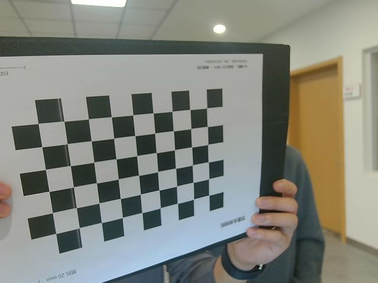
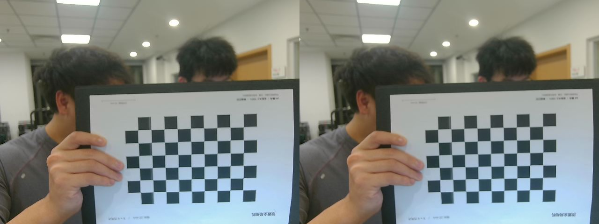
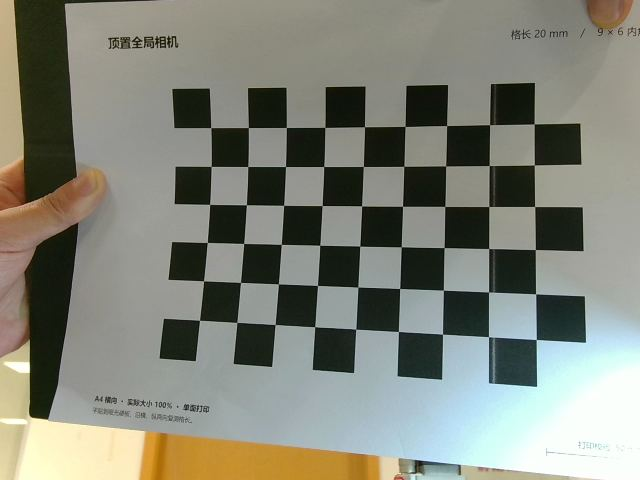
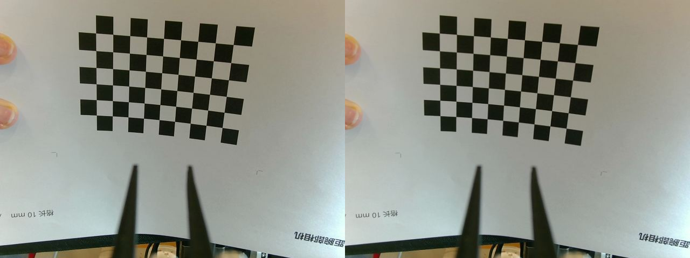
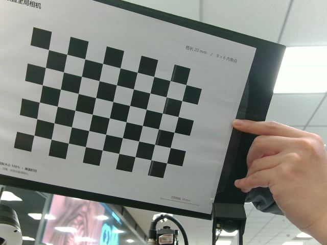
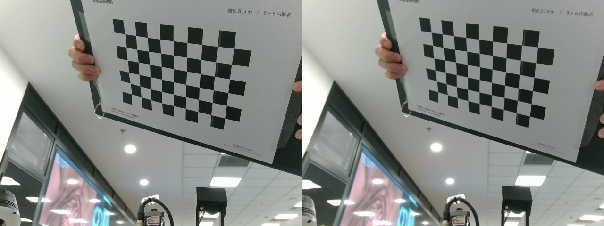

# MicroMani 三路相机内参标定报告

**标定日期：2026 年 11 月 26 日**　｜　**相机：IMX335**　｜　**图像尺寸：640 × 480 px**

三路相机的内参均通过仓库质量检查。全局使用 20 mm 棋盘，操作者左腕使用现场确认的 10 mm 棋盘，操作者右腕使用 20 mm 棋盘。下列参数可用于对应相机在标定分辨率和焦距设置下的去畸变与投影计算。

## 标定条件与验收结果

使用 OpenCV 4.13.0 和仓库脚本 `scripts/calibrate_camera.py`，通过后端快照接口采集 9 × 6 内角点棋盘图像，采用张正友法求解。三路配置帧率均为 30 fps，采集配置记录为自动曝光、自动白平衡、增益 0。

| 相机 | 格长（mm） | 有效 / 采集图像 | 重投影 RMS（px） | 4 × 4 网格覆盖 | 倾角范围 | ≥15° 视角 |
|---|---:|---:|---:|---:|---:|---:|
| 全局相机 | 20 | 25 / 25 | 0.3609 | 16/16（100.0%） | 1.93°–40.98° | 15 |
| 操作者左腕 | 10 | 24 / 25 | 0.4711 | 15/16（93.8%） | 6.80°–39.72° | 16 |
| 操作者右腕 | 20 | 25 / 25 | 0.4808 | 15/16（93.8%） | 4.90°–63.13° | 16 |

仓库的内参验收指标为总体 RMS ≤ 0.5 px、网格覆盖率 ≥ 75%、至少 3 张倾角 ≥ 15° 的视图，以及两个焦距的相对标准差均不超过 1%。左腕有一张图像的误差为 1.0628 px，超过单张 1 px 的剔除线，最终用其余 24 张重新拟合。

## 内参、畸变与实拍图

内参矩阵 `K = [[fx, 0, cx], [0, fy, cy], [0, 0, 1]]`。焦距 fx、fy 和主点 cx、cy 的单位均为像素，图像原点位于左上角。畸变向量遵循 OpenCV 顺序 `D = [k1, k2, p1, p2, k3]`，其中 k1、k2、k3 是径向系数，p1、p2 是切向系数。三路均将 k3 固定为 0。

### 全局相机（`global`）

设备身份 `20250606105`。标定结果生成于 19:15:13（北京时间）。

**内参矩阵 K**

```text
  504.523828      0.000000    345.225568
    0.000000    504.956915    242.742463
    0.000000      0.000000      1.000000
```

| 参数 | 估计值 | 估计标准差（1σ） |
|---|---:|---:|
| fx（px） | 504.523827980 | 2.215238 |
| fy（px） | 504.956914697 | 2.258551 |
| cx（px） | 345.225568196 | 1.333507 |
| cy（px） | 242.742462808 | 1.244877 |
| k1 | 0.007028205 | 0.003199 |
| k2 | -0.061572482 | 0.006863 |
| p1 | -0.003960998 | 0.000601 |
| p2 | -0.000383312 | 0.000753 |
| k3 | 0.000000000 | 固定参数 |

**采集样图**　选自参与拟合的原图 `global_20261126_190743_410751.png`，该视角重投影误差 0.3974 px。



**去畸变对照**　左半幅是原图，右半幅是同一帧去畸变后的结果。对照使用 `global_20261126_190728_135969.png`。



[下载全局相机完整精度的内参 JSON](assets/global-intrinsics.json)

### 操作者左腕（`wrist_left`）

设备身份 `PCIROOT(0)#PCI(1400)#USBROOT(0)#USB(1)#USB(4)#USB(2)`。标定结果生成于 19:48:37（北京时间）。

**内参矩阵 K**

```text
  544.906010      0.000000    315.954049
    0.000000    544.529183    237.201872
    0.000000      0.000000      1.000000
```

| 参数 | 估计值 | 估计标准差（1σ） |
|---|---:|---:|
| fx（px） | 544.906010092 | 1.307990 |
| fy（px） | 544.529183090 | 1.295325 |
| cx（px） | 315.954048935 | 1.463361 |
| cy（px） | 237.201872241 | 1.102101 |
| k1 | 0.009001519 | 0.005290 |
| k2 | -0.008686731 | 0.019850 |
| p1 | 0.002717203 | 0.000677 |
| p2 | -0.003614615 | 0.000903 |
| k3 | 0.000000000 | 固定参数 |

**采集样图**　选自参与拟合的原图 `wrist_left_20261126_193104_604527.png`，该视角重投影误差 0.9631 px。



**去畸变对照**　左半幅是原图，右半幅是同一帧去畸变后的结果。对照使用 `wrist_left_20261126_192345_006217.png`。



[下载操作者左腕完整精度的内参 JSON](assets/wrist_left-intrinsics.json)

### 操作者右腕（`wrist_right`）

设备身份 `PCIROOT(0)#PCI(1400)#USBROOT(0)#USB(5)#USB(4)#USB(3)`。标定结果生成于 19:47:30（北京时间）。

**内参矩阵 K**

```text
  563.867448      0.000000    347.665961
    0.000000    563.627040    226.840876
    0.000000      0.000000      1.000000
```

| 参数 | 估计值 | 估计标准差（1σ） |
|---|---:|---:|
| fx（px） | 563.867448144 | 2.084371 |
| fy（px） | 563.627040349 | 2.143063 |
| cx（px） | 347.665961453 | 2.104784 |
| cy（px） | 226.840875662 | 1.767517 |
| k1 | 0.067862829 | 0.008561 |
| k2 | -0.258187987 | 0.032126 |
| p1 | -0.012799408 | 0.001093 |
| p2 | 0.010463602 | 0.001187 |
| k3 | 0.000000000 | 固定参数 |

**采集样图**　选自参与拟合的原图 `wrist_right_20261126_194550_304119.png`，该视角重投影误差 0.3051 px。



**去畸变对照**　左半幅是原图，右半幅是同一帧去畸变后的结果。对照使用 `wrist_right_20261126_194527_193064.png`。



[下载操作者右腕完整精度的内参 JSON](assets/wrist_right-intrinsics.json)

## 使用与定型状态

在 OpenCV 中，将 JSON 的 `cameraMatrix` 和 `distCoeffs` 分别传给 `cv2.undistort` 的相机矩阵和畸变参数。使用其他分辨率、裁切模式或调整镜头焦距时，应重新核对内参适用性。

本次检查的三份结果目录均未包含 `reference_pose.json` 或 `checks.jsonl`。完成安装定型还需在固定工装上执行 `pose`，取走并重新放回标定板后执行 `check`。腕部两次采集应保持同一工作原点 W 姿态，复核通过线为最大角点偏移 ≤ 1 px。
