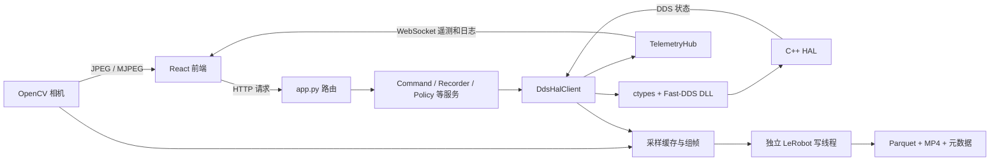

# 后端与数据知识模块：从请求到设备，再到学习样本

本文依据 2026-09-17 当前工作区源码编写，包括已修改及未跟踪的自有源码；描述的是当前文件内容，不代表这些内容已部署到正在运行的进程。阅读采用 [micromani-backend 技能](D:/E2EAPP_MicroMani/.agents/skills/micromani-backend/SKILL.md) 和 [共享后端流程](D:/E2EAPP_MicroMani/docs/ai/backend.md)。本次没有启动服务、连接设备、执行运动或运行测试。

## 1. 先理解后端承担什么

后端把浏览器操作、设备接口、录制和策略连接起来。它负责校验请求、管理配置与会话、聚合遥测、调用 HAL、组织训练数据；高频运动执行和设备侧保护主要属于 C++ HAL。后端不是一个简单的“把按钮翻译成串口命令”的程序，也不是模型训练服务器。



学习时分清四种节奏：设备控制周期、设备发布状态频率、后端采样/组帧频率、浏览器刷新频率。配置中运动线程为 1000 Hz、默认录制为 30 FPS、WebSocket 周期约 33 ms，并不意味着这些数字互相相等，也不证明实际采样达到标称值。

## 2. Python 与 Web 技术基础怎样对应到本项目

依赖以 [pyproject.toml](D:/E2EAPP_MicroMani/backend/pyproject.toml) 为准：Python ≥3.12；基础依赖包括 FastAPI、Starlette、Uvicorn、Pydantic v2、OpenCV、nidaqmx、psutil、pyserial；`dataset` 可选组引入 `lerobot[dataset]>=0.5.2`，`dev` 组提供 pytest、httpx、Ruff、mypy。版本号是依赖下限，不是已安装版本证明。基础环境装好不等于 LeRobot、视频编码器、NI 驱动和厂商 DLL 全部可用。

| 知识 | 应理解的概念 | 对应代码中的用途 |
|---|---|---|
| Python 类型与对象 | `dict`、`list`、类型提示、`Literal`、`Protocol`、`dataclass`、不可变快照 | API 请求、HAL 接口、采样记录、写盘任务和配置对象 |
| 异常 | `try/finally`、自定义异常、取消与普通错误区别 | 保证停止、资源释放、接口错误传播，不把执行结果未知误报为没执行 |
| asyncio | 事件循环、`await`、Task、Lock、取消、`wait_for` | HTTP/WS 并发、录制状态机、后台遥操作管理和看门狗 |
| 线程与进程 | 锁、队列、Future、线程池、子进程 IPC | 阻塞 SDK/相机隔离，采样与视频写盘解耦 |
| FastAPI / Starlette | ASGI、路由、请求体、响应类、WebSocket、中间件 | HTTP 入口与长连接；Uvicorn 负责运行 ASGI 应用 |
| Pydantic | 校验、序列化、`model_validate`、`model_dump` | 把外部数据变成可检查的请求与遥测结构 |
| 文件与序列化 | JSON、JSONL、Parquet、MP4、路径边界、原子替换 | 配置持久化、episode 索引和训练数据存储 |

**选型动机推断：**FastAPI 与 Python 便于把 Web API 接到数据处理及机器人学习生态；C++ HAL 用于设备 SDK 和高频执行；Pydantic 降低请求结构错误；DDS 让状态发布订阅与命令应答分离。这是从架构推断的工程取舍，不是仓库提供的性能对比实验结论。

不要把 `async def` 理解成自动在后台线程运行。它仍可能在事件循环线程执行；同步磁盘、相机、DLL 调用如果直接放进去，就会拖延其他请求和心跳。`asyncio.to_thread` 可移走普通阻塞工作，却不能安全杀死一个已经卡住的原生调用，因此 DDS 还使用专用的有界通道。

## 3. 装配、依赖与生命周期

先读 [app_factory.py](D:/E2EAPP_MicroMani/backend/app_factory.py) 的 `AppServices/create_services`，再读 [app.py](D:/E2EAPP_MicroMani/backend/app.py) 的 `create_app`。创建顺序是日志与设置 → 硬件聚合与遥测 → HAL → 共享安全门 → 遥操作、夹爪路由、命令服务 → 录制、稳定性监测与策略服务。构造参数就是依赖图，服务集中挂在 `app.state`；路由闭包共享这些实例，并非每次请求重新打开一套设备，也不是主要依赖 FastAPI `Depends` 的分层方式。

关键连接包括：录制器可触发安全中断；命令服务在活动录制期间禁止修改工作原点；录制开始检查原点；策略派发复用命令服务的轴动作校验。理解这些回调，比只看类名更能说明模块为什么不能各自独立维护一份状态。

当前用 `@app.on_event("startup")` / `shutdown` 管理启动与清理，并未改成单一 lifespan 上下文。启动会在逻辑主手均断开时清理残留 native teleop；关闭会停止看门狗、处理录制会话、取消遥操作后台任务、关闭相机与遥测执行器，并释放 DDS。各模块清理用独立异常边界，避免一个模块失败跳过其余释放。

工厂创建本身会创建运行目录、配置与日志，真实 DDS 客户端构造会启动 transport；“导入模块”和“调用 create_app”有不同副作用。学习环境应使用测试工厂替身与临时目录，不要为查看路由随手实例化真实应用。多个 Uvicorn worker 也不能按普通无状态网站思路直接增开：每个进程会拥有独立会话和设备资源。

## 4. 实际 HTTP、WebSocket 与视频入口

完整注册点集中在 [app.py](D:/E2EAPP_MicroMani/backend/app.py)。下表按功能归组，花括号为路径参数；`POST` 操作通常有状态或设备副作用，表格是阅读索引，不是要求实际调用。

| 功能 | 已注册路径 |
|---|---|
| 健康与运行 | `GET /api/health`、`/api/hardware/status`；`POST /api/runtime/shutdown`、`/api/runtime/release_handles`、`/api/hal/reconnect` |
| 设置 | `GET/PUT /api/settings`；`POST /api/settings/apply`、`/api/settings/log_command`；`GET/POST /api/settings/snapshots`；`POST .../snapshots/{snapshot_id}/apply`；`DELETE .../snapshots/{snapshot_id}` |
| 运动与原点 | `POST /api/motion/emergency_stop`、`/home_all`、`/manual_axis_move`、`/safety/acknowledge`；`GET /api/motion/origin`；`POST /api/motion/origin/{capture,clear,restore_previous}`；`POST /api/motion/{side}/{enable_all,disable_all,stop,home,return_origin}`；`POST /api/motion/{side}/origin/{capture,clear}` |
| 力与夹爪 | `POST /api/sensors/tare`、`/api/force/{side}/tare`、`/api/gripper/{side}/{command,diagnose}`；`GET /api/gripper/{side}/position` |
| 遥操作 | `POST /api/teleop/{clutch_toggle,speed}`、`/api/teleop/{side}/{connect,disconnect,gravity_compensation,zero_force_feedback}`；`GET /api/teleop/state`、`/api/teleop/mapping/status` |
| 相机 | `POST /api/cameras/{camera}/{enumerate,reconnect}`、`.../{camera}/tuning/apply`；`GET /api/cameras/enumerate`、`/api/cameras/{camera}/{snapshot,stream}` |
| PICO | `POST /api/pico/network/auto-configure`、`/api/pico/adb/connect`、`/api/pico/vision/{start,stop}`、`/api/pico/status/check` |
| 录制 | `POST /api/record/session/{create,finish}`、`/api/record/episode/{save,discard}`、`/api/record/reset/skip`；`GET /api/record/status` |
| 数据集 | `GET/POST /api/datasets`；`PATCH /api/datasets/hub`；`PATCH/DELETE /api/datasets/{dataset_id}`；`POST .../{dataset_id}/{export,split,clean,push}`、`.../{dataset_id}/review/save`；`GET .../{dataset_id}/stats` |
| episode 与文件 | `GET/PATCH/DELETE /api/datasets/{dataset_id}/episodes/{episode_id}`；`GET .../{dataset_id}/file`、`.../{dataset_id}/frame_image` |
| 模型、自动执行、微调 | `GET /api/models`；`POST /api/models/import`、`/api/models/{model_id}/{start,stop}`；`GET /api/auto/status`；`POST /api/auto/{start,stop,action,dispatch_next}`；`GET/POST /api/fine_tune/jobs`；`POST /api/fine_tune/jobs/{job_id}/cancel` |
| 策略桥与稳定性 | `GET /api/policy/observation`；`POST /api/policy/action`；`POST /api/stability/{start,stop}`；`GET /api/stability/status` |

多数业务返回 `ApiEnvelope(ok,data,ts)`，健康、硬件和部分设置/快照接口并不全部套同一外壳，JPEG/文件又是二进制响应；客户端要按实际契约读取。`HTTPException` 使用状态码及 `detail.code/message` 表达拒绝，不应把所有 HTTP 200 都理解成设备已到位。

`/ws` 发送 `telemetry`、`log`、安全中断时的 `record_status`，以及 `safety_challenge/control_lease`；接收 `safety_heartbeat`。`/ws?mode=observe` 用于观察，不取得控制权。相机 `snapshot` 返回 JPEG；`stream` 使用 `multipart/x-mixed-replace; boundary=frame` 的 MJPEG。**当前没有 SSE 路由**，不能把所有 `StreamingResponse` 都称作 SSE。

## 5. 遥测、阻塞隔离与实时性的边界

[TelemetryHub](D:/E2EAPP_MicroMani/backend/services/telemetry_hub.py) 的 `next_frame` 聚合位置、使能、主手、双侧力、夹爪、相机和进程资源信息。WS 循环默认约每 33 ms 输出，健康读缓存周期 1 s，普通状态约 50 ms；因此 UI 是抽样视图，不是全部控制日志。组帧通过 `to_thread`；相机状态和可选 NI-DAQ 显示采样另有 3 worker 的专用线程池，并限制每源同时一个 Future。

真实模式位置取 HAL 回读；测试模式可生成正弦轨迹等演示状态。读失败、未知使能、陈旧缓存分别处理，尤其右侧部分使能回读用 `None` 表示未知，不能由布尔假值直接推断物理断电。某次夹爪状态异常不会终止整条遥测和日志发送；这是模块隔离，不表示夹爪故障已修复。

[BoundedLane](D:/E2EAPP_MicroMani/backend/hal_client/bounded_lane.py) 用有界信号量和 daemon 线程执行原生阻塞调用，无等待队列：容量占满直接拒绝，超时后原生函数未返回就继续占位，不靠不断新建线程“恢复”。[DdsHalClient](D:/E2EAPP_MicroMani/backend/hal_client/dds_client.py) 分开普通命令、急停、续租、读状态和关闭通道。普通命令卡住不应耗尽急停通道；控制调用阻塞、取消、无应答等会触发 quarantine，停止正常控制及续租，并要求进程恢复，而非假装取消已经撤回硬件命令。

## 6. 控制租约、安全门与命令边界

[ControlWatchdog](D:/E2EAPP_MicroMani/backend/services/control_watchdog.py) 将浏览器主线程应答变成执行租约。默认挑战间隔 0.5 s、浏览器超时 2 s、HAL 租约 2500 ms。服务端生成 session/challenge，浏览器必须及时回相匹配的新应答；每次 HAL 续租消费新的应答，不允许依靠旧心跳持续续命。HTTP 中间件把 `X-Control-Session` 放入 `ContextVar`，运动入口校验请求属于当前控制者。当前只允许一个控制浏览器，其他窗口使用观察模式。

浏览器断开、主线程超时、HAL 续租失败会同步清掉待执行策略、使旧操作失效、锁存安全状态，然后异步急停。续租成功和明确安全确认是两个步骤；不能重连后自动恢复运动。看门狗独立于遥测组帧及默认线程池，但依然是同一 Python 事件循环任务，所以真正冻结事件循环时，还需要 HAL 侧租约过期机制托底。

[MotionSafetyGate](D:/E2EAPP_MicroMani/backend/core/motion_safety.py) 用全局/左右侧“代际”解决异步竞态：命令开始捕获 token，关键 `await` 前后复查；若期间发生停止，旧命令即使等到配置读完，也不能恢复执行。它还按任务占用运动资源、拒绝并发冲突，停止不排队等待资源。`latched` 是后端门禁，硬件急停与力锁存仍由 HAL 执行。

[CommandService](D:/E2EAPP_MicroMani/backend/services/command_service.py) 校验有限数值、步长、使能、软限位、工作原点和录制锁。大步运动分块、每块检查停止状态；捕获原点要避免陈旧/移动中的反馈，并对大漂移要求明确确认。[motion_limits.py](D:/E2EAPP_MicroMani/backend/core/motion_limits.py) 区分机械范围、工作原点与旋转工作限制，也允许受控的向合法区恢复。配置限位不等于 UI 数值原样传给 SDK。

停止命令收到超时，不代表设备没有执行；普通运动命令不能盲目重试。[protocol.py](D:/E2EAPP_MicroMani/backend/hal_client/protocol.py) 只给只读/停止类有限重试；回原点采用长超时且不自动重复。DDS 带 `request_id` 匹配应答，并为执行命令附有效期。

## 7. 当前设备路径、单位与左右侧

`make_hal_client` 在非 real 模式创建 `TestHalClient`；real 默认 DDS，明确拒绝 `transport=http`。DDS domain 默认 42，状态来自主题缓存，命令走请求/应答；[dds_runtime.py](D:/E2EAPP_MicroMani/backend/hal_client/dds_runtime.py) 用 `ctypes` 调用本仓库 C ABI DLL，后者连接 Fast-DDS。`client.py` 中仍有 HTTP 客户端、`protocol.py` 中仍有 HTTP 路径表，不代表真实运动默认走 HTTP。配置中的 `zmq` 地址也不能证明已有 ZMQ 推理通道。

当前默认力源是 `hkvl_serial`，由 HAL 管理；`force_nidaq.py` 是 `source=nidaq` 时的可选路径，包含长生命周期 DAQ Task、校准、去皮、低通和采样窗口。它与“实验室有 Nano-17”的历史硬件描述必须区分，当前实际接线、序列号和力矩单位还要结合 HAL 与标定文件核对。`GripperRouter.select` 始终选择 `NativeGripperAdapter`，`native_teleop_enabled` 当前直接返回 True；Python RS485/Jodell 驱动仍存在，但正常 API 夹爪路径不切回它。

[units.py](D:/E2EAPP_MicroMani/backend/core/units.py) 定义脉冲换算：平移 UI 用 μm，旋转用 degree；LeRobot 平移仍是 μm，旋转用 mdeg，即 0.001 degree。符号和比例来自运行配置 `motion.kinematics`。不要把带符号比例取绝对值后丢掉轴方向。

| 表达 | 排列与语义 |
|---|---|
| 12 维运动 | 左 X/Y/Z/Roll/Pitch/Yaw + 右六轴；UI 单位为 μm、degree |
| 14 维 state/action | 左六轴 + 左夹爪 + 右六轴 + 右夹爪；夹爪索引 6、13，单位 mm，旋转 mdeg |
| 12 维 pulses | 双侧六轴原始脉冲回读，与换算位置分开保存 |
| 双侧 force | 各六维 Fx/Fy/Fz/Mx/My/Mz，具体输出单位应随源与标定元数据核对 |

[operator_view.py](D:/E2EAPP_MicroMani/backend/core/operator_view.py) 明确操作者画面左侧对应历史 hardware right。显示转换、遥操作 `swapTeleopChannels`、控制卡编号、相机角色和夹爪主手来源是不同映射，不能统一按字符串 left/right 猜接线。`dmc_get_position` 默认回读也不天然等于独立外部测量的物理位姿；应学习“命令位置、控制器位置、编码器位置、外部测量位置”的区别。

## 8. 相机路径与进程知识

[camera_opencv.py](D:/E2EAPP_MicroMani/backend/drivers/camera_opencv.py) 负责设备身份/索引解析、格式与曝光设置、读帧、JPEG 编码缓存、快照和等待新帧。角色是 `global/wrist_left/wrist_right`，角色名不等于稳定 USB 索引。预览与录制消费缓存，避免每个 HTTP 请求重新打开设备。

相机隔离子进程目前是**显式可选**：`APPSTATION_CAMERA_CAPTURE_MODE=process/worker/isolated` 等，且候选后端包含 DirectShow 才进入进程路径；环境变量空值默认返回 False。普通路径使用读取与编码线程。不能因为仓库有 worker 文件就写成默认每台相机都运行子进程。

[camera_capture_worker.py](D:/E2EAPP_MicroMani/backend/workers/camera_capture_worker.py) 通过 `python -m` 启动，stdin 接收控制，stdout 逐行 JSON 回传状态和 base64 JPEG，包含 sequence、单调时间和实际格式；Windows 使用隐藏进程并处理 COM 初始化、父进程退出和资源释放。进程路径的时间戳在读帧及 JPEG 编码后生成，不能当作传感器曝光起点。应理解独立进程提高故障隔离，但多了图像编码、复制及 IPC 成本。

## 9. 录制器：会话、线程与数据格式

从 [dataset_recorder.py](D:/E2EAPP_MicroMani/backend/services/dataset_recorder.py) 的 `start_session → _sample_source_loop → FrameAssembler → LeRobotWriterThread → save_episode` 阅读，不必一开始按 4000 多行顺序通读。

会话固定配置快照并创建原生数据集、采样线程、组帧任务和写线程；episode 是一次可保存/丢弃的演示片段。保存先停止接收新帧、停止 recording 来源、排空队列，再串行执行 LeRobot `save_episode`，进入复位等待。丢弃清空未保存缓冲；已保存片段的删除主要是扩展元数据中的软删除。`reset/skip` 有原点与安全检查，名字不能解读为无条件开始。**结束会话会清理当前未保存缓冲，不是自动保存当前片段**，需要区分“保存片段”和“结束”。安全中断先保留待审片段，用户后续保存或丢弃。

源采样在线程里写 `TimedRingBuffer`；异步调度按录制 FPS 生成 `FrameAssemblyJob`；组帧队列容量 120、写帧队列容量 1200。队列阻塞超时会停止本片段，避免无限内存增长。写帧和 `open/save_episode/clear_episode/finalize` 控制命令共用同一个写线程，保证 LeRobot 不被多个线程同时操作，也防止旧 episode 的排队帧混入新片段。

新录制强制使用原生 LeRobot v3：`LeRobotDataset.create/resume/add_frame/save_episode/finalize`，视频字段始终开启，默认 h264、流式编码，视频编码队列默认 180。缺少可选依赖或初始化失败会拒绝开始/保存，旧 fallback 读取函数不意味着新录制允许伪装成原生格式。底层产物为 Parquet、MP4、LeRobot 元数据，加上 `meta/appstation_info.json` 与 `meta/episodes.jsonl` 等应用扩展；文件分块按库管理，代码还设置极小文件大小阈值推动 episode 分文件，不应硬编码“任意 v3 数据总是一 episode 一文件”。

实际 feature 是 `observation.state` 14、`observation.pulses` 12、双侧 `observation.force_*` 各 6、`action` 14，加三路图像。当前默认图像 feature 为 640×480 RGB；采集/预览的原生分辨率与训练写入形状不能混为一谈。`task` 是任务字符串，索引/时间等由 LeRobot 写入逻辑生成。

`action` 并非直接复制下一帧的实测状态：`_latest_action_vector` 将当前 observation.state 加上目标时刻之前仍新鲜的遥操作增量，旋转转成 mdeg；夹爪目标优先取 native status，特定非真机路径可取配置目标。动作历史按侧取目标时刻前的最近有效项，有 1 s 新鲜度限制，并不是累计保存所有高频命令。研究时应核对“发送目标、实际执行结果、观测时间”的因果关系，不能只因 action 与 state 同维度就把它们视作同一种数据。

## 10. 同步、质量与数据管理的真实限制

默认目标帧为 30 FPS，预热约 0.5 s，组帧延迟 100 ms，关键源等待最多约 20 ms。缓存按单调时间找最近样本；源码的候选偏差窗口包括 HAL 20 ms、force 10 ms、gripper 50 ms、omega 20 ms、camera 35 ms。过窗仍可取最近样本并标 stale；没有值时回退旧状态、旧图像或占位图。这些窗口是实现参数，不是外部测得的同步精度保证。

HAL 源采样目标可取 motionThreadHz，力源录制采样上限 200 Hz，夹爪和相机上限 60 Hz。读取的是发布缓存时，同一个设备样本可能被多次取得，因此“线程每秒读 1000 次”不能等价成 1000 条独立运动测量。HAL steady clock 与 Python monotonic 的同机时间假设、相机曝光/传输/编码延迟仍需实测；代码不是 PTP 或相机硬触发同步系统。

质量汇总包含 `lateFrames/dropCounts/staleCounts/cacheCounts`、源偏差与抖动、最低相机 FPS、最大力、警告和配置标定快照。不过 `TimedSample` 的原始时间、ok/stale 等不逐帧传入 `_native_frame_payload`，保存的主要是固定帧率训练特征和 episode 汇总；不能宣称已经无损保存全部原始高频流或逐帧质量 mask。drop 计数也不一定表示整行训练帧被删除，某些情况下表示该源使用回退值。

数据集 `split` 按排序后的 episode ID 生成 train/val/test 清单，不自动按工件/操作者分层，也不证明外部训练器会读取这个清单。`clean` 主要按帧数、迟到比例标 invalid；软删除和人工 review 不会自动物理重写全部 LeRobot Parquet。训练筛选必须明确消费这些扩展标签，不能以 UI 看不到某条 episode 推断训练库也看不到。上传 Hub 由后台任务/辅助脚本实现，不应把上传完成等同于数据审核合格。

## 11. 策略桥、模型页面与真实训练边界

[policy_bridge.py](D:/E2EAPP_MicroMani/backend/services/policy_bridge.py) 将 UI 12 维运动与两夹爪组为 14 维 state，把绝对目标 action 转成分侧增量，限制平移、旋转与夹爪单步，并带上软限位和使能轴信息。`GET /api/policy/observation` 读运动并提供力/夹爪；但力来自遥测缓存，夹爪无有效缓存时可退回配置目标，因此不是一次严格同步、全传感器新鲜的采集事务。

`POST /api/policy/action` 默认 `dryRun=true`，仅返回计划；明确发送路径才经过安全门、使能、`motion.teleop_target_update` 和夹爪命令。它与 `/api/auto/*` 的队列是两个入口；不能把 `auto.allowHardwareDispatch=false` 误认为全局封住所有策略 API。

[PolicyService](D:/E2EAPP_MicroMani/backend/services/policy_service.py) 内置 ACT/Diffusion/SmolVLA 展示项；`import_model/start_model` 主要登记内存字典及状态，没有加载权重并运行神经网络。`fine_tune` 只创建 `planned` 记录，消息明确说明执行钩子仍是手动；此处没有训练循环、梯度更新或 GPU 调度。自动动作队列最多保留 200 项，实际派发目前只支持经校验的 `manual_axis_move`，默认硬件派发关闭。

[run-act-deploy.ps1](D:/E2EAPP_MicroMani/scripts/run-act-deploy.ps1) 和 [run-act-jepa-deploy.ps1](D:/E2EAPP_MicroMani/scripts/run-act-jepa-deploy.ps1) 调用外部路径的部署脚本、checkpoint 与 Conda 环境。外部程序不属于这里已经核实的实现；这些脚本可能启停栈及连接硬件，不能作为纯学习练习执行。外部策略是否已适配新的控制租约头/心跳、相机占用和状态语义，需要联调前另行核对。

## 12. 配置、日志与自有源码地图

[SettingsService](D:/E2EAPP_MicroMani/backend/core/config.py) 默认使用 `backend/runtime`，可由 `APPSTATION_RUNTIME_DIR` 覆盖。读配置会合并默认值、版本迁移、校验，必要时回写；损坏时会恢复默认配置，因此它不是纯只读 getter。保存先做力配置验证和原点兼容处理，备份原点，再以临时文件加 `os.replace` 原子替换，并记录差异/哈希。配置快照与工作原点备份位于运行目录；数据集默认另在 `~/.appstation/datasets`。

`AppConfig` 顶层 `extra="forbid"`，但各大分区多数是 `dict[str,Any]`；不能宣称所有内部字段都有严格 Pydantic 验证。保存 JSON、应用运行配置、HAL 接受配置、设备实际生效是不同步骤，应沿 `/settings/apply` 的调用链判断。默认配置含历史机器绝对路径和 COM 口，必须按当前机器确认，不能当成便携自动发现。

| 源码入口 | 应掌握的职责 |
|---|---|
| [app.py](D:/E2EAPP_MicroMani/backend/app.py)、[app_factory.py](D:/E2EAPP_MicroMani/backend/app_factory.py) | API/WS、错误、生命周期、实例装配、部署状态检测 |
| [schemas.py](D:/E2EAPP_MicroMani/backend/core/schemas.py)、[defaults.py](D:/E2EAPP_MicroMani/backend/core/defaults.py)、[config.py](D:/E2EAPP_MicroMani/backend/core/config.py) | 请求/遥测结构、默认硬件参数、迁移与快照 |
| [units.py](D:/E2EAPP_MicroMani/backend/core/units.py)、[operator_view.py](D:/E2EAPP_MicroMani/backend/core/operator_view.py)、[motion_limits.py](D:/E2EAPP_MicroMani/backend/core/motion_limits.py) | 单位、左右、工作坐标与限位 |
| [motion_safety.py](D:/E2EAPP_MicroMani/backend/core/motion_safety.py)、[gripper_protection.py](D:/E2EAPP_MicroMani/backend/core/gripper_protection.py)、[force_config.py](D:/E2EAPP_MicroMani/backend/core/force_config.py) | 竞态阻断、夹爪最小间距、力源与安全配置载荷 |
| [logging.py](D:/E2EAPP_MicroMani/backend/core/logging.py) | 日志序号、WS 增量读取、会话与结构化诊断、配置哈希 |
| [command_service.py](D:/E2EAPP_MicroMani/backend/services/command_service.py)、[control_watchdog.py](D:/E2EAPP_MicroMani/backend/services/control_watchdog.py) | 运动入口与浏览器/HAL 双层租约 |
| [teleop_mapping.py](D:/E2EAPP_MicroMani/backend/services/teleop_mapping.py) | native 遥操作配置/启动/停止、来源集合与状态采样；高频映射执行在 HAL |
| [gripper_backend.py](D:/E2EAPP_MicroMani/backend/services/gripper_backend.py)、[gripper_router.py](D:/E2EAPP_MicroMani/backend/services/gripper_router.py) | 原生夹爪适配、统一命令与状态接口 |
| [hardware_service.py](D:/E2EAPP_MicroMani/backend/services/hardware_service.py)、[telemetry_hub.py](D:/E2EAPP_MicroMani/backend/services/telemetry_hub.py) | Python 驱动聚合与显示快照 |
| [dataset_recorder.py](D:/E2EAPP_MicroMani/backend/services/dataset_recorder.py) | 录制状态机、时间缓存、写线程、质量、数据集 API |
| [policy_bridge.py](D:/E2EAPP_MicroMani/backend/services/policy_bridge.py)、[policy_service.py](D:/E2EAPP_MicroMani/backend/services/policy_service.py) | 14 维动作桥、模型登记和有限队列派发 |
| [stability_monitor.py](D:/E2EAPP_MicroMani/backend/services/stability_monitor.py)、[pico_network.py](D:/E2EAPP_MicroMani/backend/services/pico_network.py) | 稳定性观察；PICO 网络信息发现，不是模型模块 |
| [camera_opencv.py](D:/E2EAPP_MicroMani/backend/drivers/camera_opencv.py)、[camera_capture_worker.py](D:/E2EAPP_MicroMani/backend/workers/camera_capture_worker.py) | 相机线程/可选进程、格式协商与缓存 |
| [force_nidaq.py](D:/E2EAPP_MicroMani/backend/drivers/force_nidaq.py)、[gripper_rs485.py](D:/E2EAPP_MicroMani/backend/drivers/gripper_rs485.py)、[pico_adb.py](D:/E2EAPP_MicroMani/backend/drivers/pico_adb.py) | 可选 NI-DAQ、保留的 Python 夹爪 SDK、ADB 与外部视觉脚本 |
| [client.py](D:/E2EAPP_MicroMani/backend/hal_client/client.py)、[protocol.py](D:/E2EAPP_MicroMani/backend/hal_client/protocol.py)、[dds_types.py](D:/E2EAPP_MicroMani/backend/hal_client/dds_types.py) | 抽象/测试/兼容客户端、命令语义、主题与信封 |
| [dds_client.py](D:/E2EAPP_MicroMani/backend/hal_client/dds_client.py)、[bounded_lane.py](D:/E2EAPP_MicroMani/backend/hal_client/bounded_lane.py)、[dds_runtime.py](D:/E2EAPP_MicroMani/backend/hal_client/dds_runtime.py) | 异步适配、原生阻塞隔离、ctypes ABI |
| [appstation_fastdds_transport.cpp](D:/E2EAPP_MicroMani/backend/native/appstation_fastdds_transport.cpp)、[build_fastdds_transport.cmd](D:/E2EAPP_MicroMani/backend/native/build_fastdds_transport.cmd) | C ABI、DDS 缓存与条件变量应答；DLL 构建 |

各目录 `__init__.py` 是 Python 包入口；`vendor/jodell` 为外部依赖，不作为自有算法学习。`teleop_mapping.py` 按 `recording/teleop-connect/manual-gripper` 来源管理共享控制器，停止一种来源不能意外停止其余有效来源，也不能在急停后借其余来源重启。

## 13. 分阶段学习与离线练习

1. **先会读契约。**读 schemas、units、operator_view，手算一次 12→14 维转换：左 Roll=0.2 degree 应变成 state[3]=200 mdeg；确认右臂从索引 7 开始。练习画出硬件侧、操作者侧、主手来源三张映射表。
2. **再追一次请求。**从手动轴路由到 CommandService、DDS command、HAL 返回，写出各步骤的输入/输出、单位和可能拒绝理由。只做阅读，区分等待应答和等待运动到位。
3. **理解并发失效。**画出“请求等待 HAL → 用户急停 → 旧请求返回”的时间线，说明 generation 为什么阻止后半段执行。用测试替身注入延迟，不用真实 SDK。
4. **读录制流水线。**构造时间为 0、20、40 ms 的假样本，推演 nearest、超窗、缓存回退；核对写队列顺序，解释为何保存不能越过尚未写完的帧。
5. **读一个临时数据集。**在替身与临时目录中检查 feature、episode 边界、原点快照和质量报告；分别统计“可加载”“低质量”“任务成功”，不要合并为一个指标。
6. **最后接学习算法。**先离线读取和验证动作单位，再研究 ACT/Diffusion 输入输出；查清外部训练器如何筛选 invalid/soft-delete 和 splits，再考虑部署接入。

相关测试是可执行规格：单位/左右看 `test_units.py/test_operator_view.py`；请求/配置看 `test_app.py/test_force_config.py/test_hardware_defaults.py`；录制/策略看 `test_dataset_recorder.py/test_policy_bridge.py`；并发/租约看 `test_control_watchdog.py/test_control_stop_races.py/test_dds_blocking_isolation.py/test_review_remediation.py`；模块隔离看 `test_module_isolation.py`；相机、NI-DAQ、夹爪、PICO、DDS 各有同名测试。其余源契约、脚本、原点迁移及原生验收报告测试连接跨层约定，可在 [tests 目录](D:/E2EAPP_MicroMani/backend/tests) 按主题阅读。

在仓库根目录、先核对测试使用替身和临时目录后，可分组运行：

```powershell
backend/.venv/Scripts/python.exe -m pytest backend/tests/test_units.py backend/tests/test_operator_view.py -q
backend/.venv/Scripts/python.exe -m pytest backend/tests/test_control_watchdog.py backend/tests/test_control_stop_races.py backend/tests/test_dds_blocking_isolation.py -q
backend/.venv/Scripts/python.exe -m pytest backend/tests/test_dataset_recorder.py backend/tests/test_policy_bridge.py -q
```

仅设置 `APPSTATION_HAL_MODE=test` 不会自动替换相机、PICO 或 NI 驱动。可选 LeRobot 缺失可能 skip；本次只读检查，以上命令均未执行，也没有实机精度、频率或安全验证结论。

## 14. 整合时仍需跨层核对

- 前端：左右转换具体在哪一层发生；`controlLease/telemetryIngress` 如何响应挑战与过期；哪类错误会保留旧显示；MJPEG 与快照选择；按钮状态是否正确反映后端锁存。
- HAL：DDS topic/IDL/ABI 一致性、状态发布时间与原始测量时间、执行侧租约及命令过期、力数据单位、位置回读来源、native teleop `deltaVector/actionHistory` 是哪阶段的目标增量。
- 启动脚本：实际环境变量、相机 thread/process 模式、DLL 搜索路径与 `.next` 部署、测试模式隔离；当前默认值不等于某台电脑已加载的 runtime 配置。
- 外部策略工程：训练与部署代码位置、相机占用、14 维单位及原点约定、控制租约兼容、对扩展质量标签和 splits 的消费。

官方资料入口供学习，整合时核验当前文档版本：[Python asyncio](https://docs.python.org/3/library/asyncio.html)、[FastAPI](https://fastapi.tiangolo.com/)、[Starlette WebSockets](https://www.starlette.io/websockets/)、[Pydantic](https://docs.pydantic.dev/latest/)、[LeRobot 数据格式](https://huggingface.co/docs/lerobot/lerobot-dataset-v3)、[Fast DDS](https://fast-dds.docs.eprosima.com/)。仓库行为应以本地实现与对应测试为准，官方通用示例不能替代设备路径核对。
