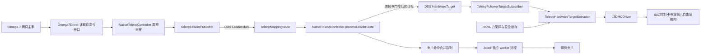

# HAL、DDS 与设备执行：把软件意图变成可约束的物理动作

本节依据 2026-09-17 工作区当前源码梳理；只读代码，没有启动 HAL、连接设备、编译或执行实机测试。默认配置只代表代码选择，不能证明实验室当前接线或实际运行配置。

## 1. 先建立分层认识

HAL（Hardware Abstraction Layer，硬件抽象层）把“左侧 X 轴移动 10 μm”转换成“哪张卡、哪个轴、什么方向、多少脉冲、什么速度”，并在最后执行边界检查安全状态。后端管理业务、配置和采集；HAL 管理设备接口、高频遥操作映射和执行约束。两者是不同进程和不同职责。

目前 HAL 为 Windows C++20 程序，使用 MSVC、Winsock、Fast-DDS/Fast-CDR 及厂商 DLL。C++20 是构建文件的明确要求；`ControlLeaseGuardian` 实际使用了 C++20 的 `std::jthread`、`std::stop_token`。选择 C++承接原生 SDK、控制资源生命周期并减少高频循环中解释器调度影响，是基于结构的设计解释，不是作者动机记录或性能测量结论。

**学习顺序：**C++ 类型和对象生命周期 → 线程同步 → Windows DLL → DDS 通信 → 单位和运动映射 → 驱动执行 → 安全状态机。理解这些之后，再研究滤波和柔顺控制，否则容易只看懂公式而误判执行条件。

## 2. 当前真实遥操作链路

装配入口在 [HalServer.cpp](D:/E2EAPP_MicroMani/hal/src/HalServer.cpp)。`APPSTATION_TELEOP_EXECUTOR` 缺省为 `dds_follower`，但实际启用还要求 Leader、Mapping、Follower 三个 DDS 组件可用；它们受编译开关和运行时 `APPSTATION_HAL_DDS_ENABLED` 控制。条件不足时保留进程内映射与执行路径，不能仅凭缺省模式断定实际走 DDS。

Leader、Mapping、Follower 当前由同一个 `HalServer` 进程创建，是通信和职责边界，并非已经部署成三台计算机。默认 DDS Domain ID 为 42，LAN discovery 未打开时限制 loopback。跨机部署还需要验证发现、时钟、延迟、丢包与安全条件。

`NativeTeleopController::tick` 读取主手后，若已接入 Leader 发布回调，就发布后返回；Mapping 收到样本才调用 `processLeaderState`。Python 不在这条逐帧主手映射环内。进程内分支直接调用运动驱动；当前 X/Z 柔顺叠加位于 Follower 执行器，因此两种模式的功能不能视为完全等价。

## 3. DDS：理解消息契约与通信质量

DDS 是以 Topic 为中心的发布订阅通信。先掌握 DomainParticipant、Topic、类型、DataWriter、DataReader，再学习 QoS。IDL 描述线上字段；CDR/XCDR 负责序列化；QoS 约束可靠性、历史深度、持久性等。它们不能代替业务安全校验。

核心契约是 [appstation_hal.idl](D:/E2EAPP_MicroMani/hal/dds/appstation_hal.idl)。本项目在 C++ 中手写类型镜像和序列化，而不是只依赖 IDL 自动生成代码；改动字段必须同时核对 HAL、Python 类型声明、后端原生传输库的字段顺序、宽度、名称与含义。

| 消息类别 | 当前实现 | 需要理解的取舍 |
|---|---|---|
| Health | Reliable、Transient Local、历史深度 1 | 支持后来加入的读者获得保留健康样本；样本仍须判断新鲜度 |
| Motion/Omega/NativeTeleop/Force 状态 | Best Effort、Volatile、深度 1 | 偏向最近状态，允许丢中间帧；不等于完整数据录制 |
| CommandRequest / CommandReply | Reliable、Volatile、深度 32 | 用 request_id 关联请求应答；可靠传输不等于业务“恰好执行一次” |
| EmergencyStop | 独立 Topic 和读线程 | 急停及控制租约续期避开普通命令阻塞 |
| LeaderState | Writer 深度 1、Mapping Reader 深度 8，Best Effort | 采样与映射异步，不能把发送时刻当执行时刻 |
| HardwareTarget | Writer/Reader 深度 8，Best Effort | 回调批量取出并逐条处理；并非只执行批次最后一个 |

对应 [HalDdsControlServer.cpp](D:/E2EAPP_MicroMani/hal/src/HalDdsControlServer.cpp)、[TeleopMappingNode.cpp](D:/E2EAPP_MicroMani/hal/src/TeleopMappingNode.cpp)。

必须区分三种语义：

1. **command：**请求执行某项操作。`reply.ok=true` 表示处理函数返回成功；夹爪可能只是进入队列，运动目标可能刚交给控制卡。完成条件取决于具体命令，不能统一解释为“机构已到位”。
2. **state：**采样或缓存快照。LTDMC 抢锁失败时可返回缓存；服务在线不代表位置是刚刚从硬件读取的。
3. **ACK：**通信应答是 `request_id` 对应的 reply；`motion.acknowledge_estop` 是操作者显式解除软件锁存，两者含义完全不同。后者返回 `servoRestored:false`，不会恢复伺服或重放旧运动。

当前 HardwareTarget 携带 `sequence`，但 Follower 未实现完整的序号去重与一般年龄窗口拒绝；执行器检查急停状态和目标是否早于最近急停。不能写成“所有过期 DDS 数据都已自动拒绝”。普通命令的 deadline 是另一套机制。

HAL HTTP 只保留本机 `/health`、`/force/state` 诊断路由，不承接真实业务运动控制。`/health` 内部会调用 `hal.reconnect` 并尝试 `omega.ensureReady`，因此它也不能当作绝无设备副作用的离线学习命令。来源：[HalHttpServer.cpp](D:/E2EAPP_MicroMani/hal/src/HalHttpServer.cpp)。

## 4. 运动几何、单位与左右侧别

每侧轴顺序是 `X/Y/Z/Roll/Pitch/Yaw`，两侧形成 12 维运动状态。语义轴不是控制卡物理轴号：HAL 左侧映射 `[0,1,3,5,4,2]`，右侧映射 `[2,0,5,8,1,7]`，见 [HalTypes.h](D:/E2EAPP_MicroMani/hal/include/HalTypes.h)。旋转三个分量表达姿态约定，不应把当前逐轴映射夸大为实现了完整机器人逆运动学。

| 数据所在位置 | 平移 | 旋转 | 夹爪 |
|---|---|---|---|
| Omega.7 位姿/开口原始读取 | m | degree | m |
| UI / HAL 语义运动增量 | μm | degree | 目标通常为 mm |
| LTDMC 执行 | pulse | pulse | 不属于 LTDMC 十二轴 |
| LeRobot 运动状态部分 | μm | 0.001 degree | 由独立状态契约定义 |

平移轴系数 `K_t` 的单位为 pulse/mm，`pulse=(μm/1000)×K_t`；旋转轴系数 `K_r` 的单位为 pulse/degree，`pulse=degree×K_r`。系数符号同时表示轴方向。例如 HAL 左侧 X 系数为 −5000 pulse/mm，+10 μm 对应 −50 pulse。脉冲分辨率不等于实际定位精度，还受机构误差、回差、反馈和标定影响。

**当前源码有一处值得学习的注释差异：**`TeleopDdsTypes.h` 把 `deltas` 注释为 pulse；实际产生者 `incrementalDeltasUi/velocityDeltasUi` 输出 UI 单位，消费者 `updateTeleopTargetUi` 也接收 UI 单位，柔顺还直接叠加 μm。故当前执行语义是平移 μm、旋转 degree；本说明以产生者和消费者为准，未修改源代码。

左右侧别有四个层次：物理主手、逻辑主手、硬件机构、操作者视角。`swapHands` 是主手设备绑定；`swapTeleopChannels` 是主从通道交换；[operator_view.py](D:/E2EAPP_MicroMani/backend/core/operator_view.py) 是操作者与历史硬件名称转换，不能随意合并。当前操作者 left 对应硬件 right；夹爪来源也走显式映射。单位跨层核对 [units.py](D:/E2EAPP_MicroMani/backend/core/units.py)。

学习增量位置控制时，追踪“首帧捕获参考 → 当前与参考作差 → 缩放/死区 → 小脉冲累积 → 限幅 → 更新目标 → 推进参考”。首帧只建立参考；主手读取失败会停止对应目标并清除参考；开启 `requireClutch` 时，未按下 clutch 也会触发该处理，该配置默认关闭。速度模式则是“输入位姿 → 死区/归一化 → 速度平滑 → 乘 dt 得增量”。还要理解目标位置与实测位置的区别，以及用累计目标实现平滑续推时为什么需要限制目标超前量。

可选 Kalman 使用每轴 `[位置,速度]` 状态，学习状态预测、测量更新、P/Q/R 与意图权重；默认是否开启以配置为准，头文件缺省为关闭。滤波减少抖动也引入响应变化，不能宣称开启就必然提高装配精度。

## 5. 力测量与柔顺控制

用户课题介绍含两只 Nano-17；**当前代码缺省选择 `hkvl_serial`**，并保留 NI-DAQ 路径。HAL 现有原生驱动是 HKVL，不能把这些名称当作同一硬件。后续论文应分别写“实验室硬件条件”“当前软件接入实现”“实际验证配置”。HKVL 缺省串口、1000 Hz 期望采样率等也是配置，不能替代现场核对。

HKVL 数据路径为：串口字节流 → 28 字节帧解析 → CRC → 有限数检查 → 原始六维力/力矩 → 去皮 → 滤波 → 轴方向校准。学习字节序、IEEE 754 float、流式缓冲、半帧/粘帧、重同步；CRC 只校验传输，不能证明传感器标定正确。对应 [HkvlForceProtocol.cpp](D:/E2EAPP_MicroMani/hal/src/HkvlForceProtocol.cpp)、[HkvlForceDriver.cpp](D:/E2EAPP_MicroMani/hal/src/HkvlForceDriver.cpp)。

安全检测使用**方向校准后的去皮值**，柔顺使用滤波值，避免把低通滤波延迟带入主要超限判定。当前配置为普通停机阈值同通道连续三帧达到时锁存，达到停机阈值 120% 时单帧锁存；缺样、断连或过期也可锁存。默认 watchdog 50 ms、确认稳定窗口 500 ms；这些不是适用于所有微装配任务的安全推荐值。

柔顺目前只作用于 X/Z：二维映射矩阵把 `Fx/Fz` 投影到运动修正方向，经死区后使用近似关系 `Δx=K×F×Δt`，再限制单步修正和会话累计偏移。`K` 单位是 μm/(N·s)，`dt` 最大按 20 ms 处理。它更接近有限维、离散的导纳式修正，不是完整六维阻抗控制。

柔顺启用条件包括开关开启、侧别映射确认、力样本有效新鲜及未锁存；执行器按实际应用位移回写累计修正，防止软限位截断后内部继续累计未执行量。应学习坐标标定、正负反馈、饱和、积分累积、采样周期和接触稳定性；公式正确不代表增益已能安全用于实机。来源：[ForceComplianceController.cpp](D:/E2EAPP_MicroMani/hal/src/ForceComplianceController.cpp)、[ForceControlRuntime.cpp](D:/E2EAPP_MicroMani/hal/src/ForceControlRuntime.cpp)。

## 6. 安全体系：撤销权限、停车、确认、重新使能

核心原则是执行侧拒绝危险动作；网页禁用按钮只是交互提示。需要把安全系统当成状态机，而不是一个布尔开关。

| 机制 | 当前行为与学习重点 |
|---|---|
| 运动约束 | 驱动检查急停/租约/命令代际/伺服状态；遥操作执行还有启用轴、死区、单步限幅、软限位和目标超前限制。不同运动入口的约束须逐一追踪，不能假定完全相同 |
| 急停代际 | `EmergencyStopState` 用同一个原子状态保存代际和锁存位；新急停改变 epoch，旧命令即使后来获得锁也不能继续执行 |
| 多设备停机 | Dispatcher 先锁存权限，再依次尝试运动停止、遥操作清理、主手力输出关闭、力锁存记账；某一步失败仍尝试其他步骤 |
| 控制租约 | sessionId、递增 sequence、2500 ms 到期；独立 guardian 检查。迟到续租必须先记录到期急停，续租不自动解除锁存；活跃所有者不能被另一会话抢占 |
| 普通命令过期 | `commandExpiresAtUnixMs` 在执行前校验，防止后端已超时的动作稍后从队列执行。旧客户端可省略，因此不是所有请求天然具备 deadline |
| 力锁存恢复 | HKVL 双侧在线、样本新鲜、全部低于警告值并维持稳定窗口；停机回调/worker 故障还会阻止确认 |
| 确认后行为 | 匹配观察到的急停代际、租约有效且停车动作完成，才能清锁存；不自动使能伺服、不自动恢复遥操作 |

关键文件：[EmergencyStopState.h](D:/E2EAPP_MicroMani/hal/include/EmergencyStopState.h)、[ControlLeaseState.h](D:/E2EAPP_MicroMani/hal/include/ControlLeaseState.h)、[ControlLeaseGuardian.h](D:/E2EAPP_MicroMani/hal/include/ControlLeaseGuardian.h)、[CommandDeadline.h](D:/E2EAPP_MicroMani/hal/include/CommandDeadline.h)、[HalCommandDispatcher.cpp](D:/E2EAPP_MicroMani/hal/src/HalCommandDispatcher.cpp)。

恢复须区分原因：普通安全锁存满足条件后显式确认；Force worker/停机回调故障要求先诊断并重新配置；租约 guardian 失败会撤销其可续租资格，心跳无法恢复，需要重建运行生命周期。不能把“重新连接网络”当作所有故障的统一恢复方式。

## 7. 并发、资源所有权与真实时间性能

当前主要执行单元包括：原生主手循环、运动状态轮询、两侧力串口读取、力 watchdog、DDS 普通命令与遥测线程、DDS 急停/租约线程、DDS 回调、独立租约 guardian、夹爪命令线程和每侧夹爪 worker 进程。

学习它们时分别回答：谁创建资源？谁持有句柄？谁修改状态？哪把锁保护它？停止时谁先撤销回调，谁等待线程结束？`mutex` 保护复合状态，`atomic` 保护轻量门控；原子布尔不自动让一整套状态一致。`condition_variable` 唤醒夹爪队列，避免持续空转；`join` 回收线程，RAII 在异常退出时也执行清理。

夹爪分离有两个层次：从高频运动循环移到独立线程，隔离串口阻塞；再用每侧进程隔离厂商 DLL 的全局串口状态。当前队列每侧保留最新目标，并配置命令间隔，旧中间目标可以合并；这不是保证每一个输入目标都被执行的队列。

代码中的频率要准确表述：Native 缺省 100 Hz；运动状态轮询入口设为 1000 Hz；普通遥测目标 100 Hz，力状态发布目标 5 ms 一次。普通命令和遥测共线程，长命令可拖延遥测；Windows 调度、SDK、锁竞争、DDS 都会影响实际周期。因此是目标周期/尽力调度，不是硬实时保证或实测性能。

`runWorkerBoundary` 阻止异常逃出线程/回调边界；故障会停止工作、锁存权限并保留诊断，不应仅打印后继续。析构时要先撤销控制权限，停止仍持回调的线程，再销毁被调用对象，防止悬空引用。[HalServer.cpp](D:/E2EAPP_MicroMani/hal/src/HalServer.cpp) 的 shutdown 对象是学习资源依赖和逆序释放的入口。

## 8. 构建、SDK、DLL 与 ABI

先学区分：`.h` 声明接口、`.cpp` 实现、`.obj` 编译产物、`.lib` 静态库或导入库、`.dll` 运行时动态库、`.exe` 进程入口。CMake 描述目标和依赖；MSVC 编译、链接。链接成功不代表运行时找得到 DLL，也不代表设备可用。

[CMakeLists.txt](D:/E2EAPP_MicroMani/hal/CMakeLists.txt) 定义核心库、HalServer、JodellGripperWorker；厂商 SDK 与 DDS 可显式关闭。Fast-DDS/Fast-CDR 链接 ROS 目录提供的预编译库，不代表应用业务已经使用 ROS 2 节点、服务或 ros2_control。

LTDMC/Omega/Jodell 使用 `LoadLibrary`、`GetProcAddress` 绑定厂商导出，函数指针签名、返回类型、参数宽度、调用约定必须匹配。ABI 关注 x64/x86、运行库、布局与所有权；函数同名不表示二进制兼容。C++中的异常不能无约定跨 DLL/语言边界传播。

后端原生 DDS 库 [appstation_fastdds_transport.cpp](D:/E2EAPP_MicroMani/backend/native/appstation_fastdds_transport.cpp) 使用 `extern "C"` 导出与缓冲区/句柄接口，供 Python 桥接调用；这是另一处值得学习的 C ABI 边界。

[build_hal.cmd](D:/E2EAPP_MicroMani/hal/build_hal.cmd) 不仅编译：它会运行 ForceCoreTests 并尝试推广 `.next.exe` 为正式二进制。学习时先读脚本，不把它当作无副作用测试命令。当前 CMake 未注册这些测试为 CTest 目标，不能用空的 `ctest` 输出声称已完成验证。

## 9. 逐文件知识映射与阅读目的

每个模块建议“先读同名头文件接口，再读下列实现”，这样先理解边界，再看细节。

| 文件入口 | 学习内容与完成标志 |
|---|---|
| [HalServer.cpp](D:/E2EAPP_MicroMani/hal/src/HalServer.cpp) | 依赖注入、生命周期装配；画出创建和销毁顺序 |
| [HalCommandDispatcher.cpp](D:/E2EAPP_MicroMani/hal/src/HalCommandDispatcher.cpp) | 命令路由、参数解析和权限；追踪一个手动移动与一个拒绝路径 |
| [HalJson.cpp](D:/E2EAPP_MicroMani/hal/src/HalJson.cpp) | JSON与强类型配置互转；说明缺省值和跨层字段影响 |
| [HalDdsControlServer.cpp](D:/E2EAPP_MicroMani/hal/src/HalDdsControlServer.cpp) | 控制面QoS、请求应答、遥测调度、急停通道 |
| [HalHttpServer.cpp](D:/E2EAPP_MicroMani/hal/src/HalHttpServer.cpp) | Winsock、请求上限、超时、有界连接worker |
| [TeleopLeaderPublisher.cpp](D:/E2EAPP_MicroMani/hal/src/TeleopLeaderPublisher.cpp) | 主手样本包装、双时间戳、发布 |
| [TeleopMappingNode.cpp](D:/E2EAPP_MicroMani/hal/src/TeleopMappingNode.cpp) | 订阅回调、dt估算、目标序列化 |
| [TeleopFollowerTargetSubscriber.cpp](D:/E2EAPP_MicroMani/hal/src/TeleopFollowerTargetSubscriber.cpp) | 批量take、回调退出和对象存活 |
| [TeleopHardwareTargetExecutor.cpp](D:/E2EAPP_MicroMani/hal/src/TeleopHardwareTargetExecutor.cpp) | 最终执行边界、柔顺叠加、实际修正反馈 |
| [NativeTeleopController.cpp](D:/E2EAPP_MicroMani/hal/src/NativeTeleopController.cpp) | 主从映射、参考重捕获、滤波、残差累积、夹爪队列 |
| [LTDMCDriver.cpp](D:/E2EAPP_MicroMani/hal/src/LTDMCDriver.cpp) | 物理轴、脉冲、运动曲线、目标续推、软限位、SDK返回值 |
| [MotionControlThread.cpp](D:/E2EAPP_MicroMani/hal/src/MotionControlThread.cpp) | 周期轮询、异常出口、线程重启与join |
| [Omega7Driver.cpp](D:/E2EAPP_MicroMani/hal/src/Omega7Driver.cpp) | 设备枚举、句柄与openId、读取状态、重力补偿和零力 |
| [JodellGripperDriver.cpp](D:/E2EAPP_MicroMani/hal/src/JodellGripperDriver.cpp) | 开口换算、DLL绑定、管道通信、worker超时 |
| [JodellGripperWorker.cpp](D:/E2EAPP_MicroMani/hal/src/JodellGripperWorker.cpp) | 隔离进程入口和命令协议 |
| [HkvlForceProtocol.cpp](D:/E2EAPP_MicroMani/hal/src/HkvlForceProtocol.cpp) | 字节流、CRC、有限数和错误统计 |
| [HkvlForceDriver.cpp](D:/E2EAPP_MicroMani/hal/src/HkvlForceDriver.cpp) | 双串口线程、去皮提交、低通、快照 |
| [ForceSafetyLatch.cpp](D:/E2EAPP_MicroMani/hal/src/ForceSafetyLatch.cpp) | 超限计数、watchdog和恢复稳定窗口 |
| [ForceComplianceController.cpp](D:/E2EAPP_MicroMani/hal/src/ForceComplianceController.cpp) | 离散柔顺、饱和、实际执行量反馈 |
| [ForceControlRuntime.cpp](D:/E2EAPP_MicroMani/hal/src/ForceControlRuntime.cpp) | 力数据管线、回调、锁存与配置生命周期 |

## 10. 离线验证与练习

测试也是可执行的需求说明。先读断言，再反查实现，不把测试文件存在当作本次运行通过。

| 测试文件 | 能学习的可观察行为 |
|---|---|
| [ForceCoreTests.cpp](D:/E2EAPP_MicroMani/hal/tests/ForceCoreTests.cpp) | 拆帧/CRC、默认配置、力安全、柔顺、方向和配置解析 |
| [EmergencyStopTests.cpp](D:/E2EAPP_MicroMani/hal/tests/EmergencyStopTests.cpp) | 急停代际、旧目标、非法数、去皮拒绝及确认竞态 |
| [ControlLeaseTests.cpp](D:/E2EAPP_MicroMani/hal/tests/ControlLeaseTests.cpp) | 默认禁止运动、迟到心跳、重放、会话归属、guardian关闭 |
| [ThreadStabilityTests.cpp](D:/E2EAPP_MicroMani/hal/tests/ThreadStabilityTests.cpp) | 发布异常、停机回调异常、有界HTTP连接与资源释放 |
| [WorkerResilienceTests.cpp](D:/E2EAPP_MicroMani/hal/tests/WorkerResilienceTests.cpp) | 线程创建/运行失败、串口部分启动失败、Follower异常、命令过期 |
| [test_hal_source_contracts.py](D:/E2EAPP_MicroMani/backend/tests/test_hal_source_contracts.py) | 跨层源码约束；多为文本/结构检查，不能等同C++执行测试 |
| [test_hal_protocol.py](D:/E2EAPP_MicroMani/backend/tests/test_hal_protocol.py) | 命令名、payload与请求策略 |
| [test_hal_dds_client.py](D:/E2EAPP_MicroMani/backend/tests/test_hal_dds_client.py) | 缓存读取、request_id、超时和避免重发变更命令 |
| [test_hal_native_acceptance_report.py](D:/E2EAPP_MicroMani/backend/tests/test_hal_native_acceptance_report.py) | 验收报告所需证据；验证报告校验器不代表做了实机验收 |

建议依次完成以下离线作业：

1. 手算左X与右Yaw各一次UI↔pulse转换，再核对已有单位测试；说明为什么旋转数据进入LeRobot要乘1000。
2. 用纸面状态表推演“启动→续租→确认→使能→租约到期→迟到心跳”，标出哪些步骤仍不能运动。
3. 阅读现有ForceCoreTests的伪造帧，说明一帧拆两次到达、CRC失败、NaN输入分别如何处理。
4. 追踪“发布成功但follower尚未执行”。DDS模式`recordPublishedTargetActionUnlocked`记录的是发布端目标，不能当成已执行轨迹；比较进程内`recordActionUnlocked`才有的驱动结果。
5. 为普通命令画“发送→排队→deadline过期→HAL拒绝→reply错误”的时序图；再解释急停为何不应因为普通deadline过期而被拒绝。
6. 阅读并运行所需的Python离线契约测试；需要C++编译时使用独立构建目录并显式关闭DDS/厂商SDK，区分骨架编译、原生单测、DDS运行和实机四种证据。

这些练习不需要启动设备。完成后应能从一个界面动作追到DLL调用，并解释它的单位、线程、消息、新鲜度、拒绝条件及恢复条件。
