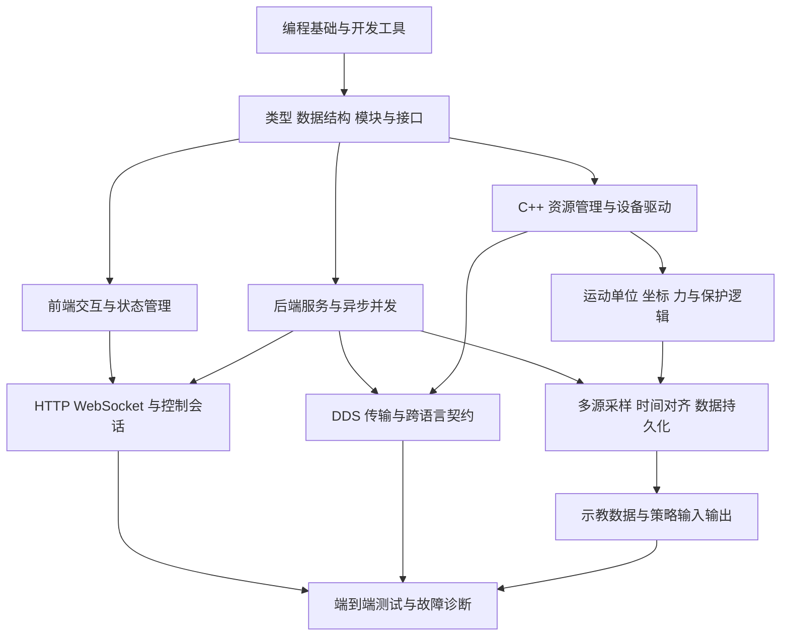
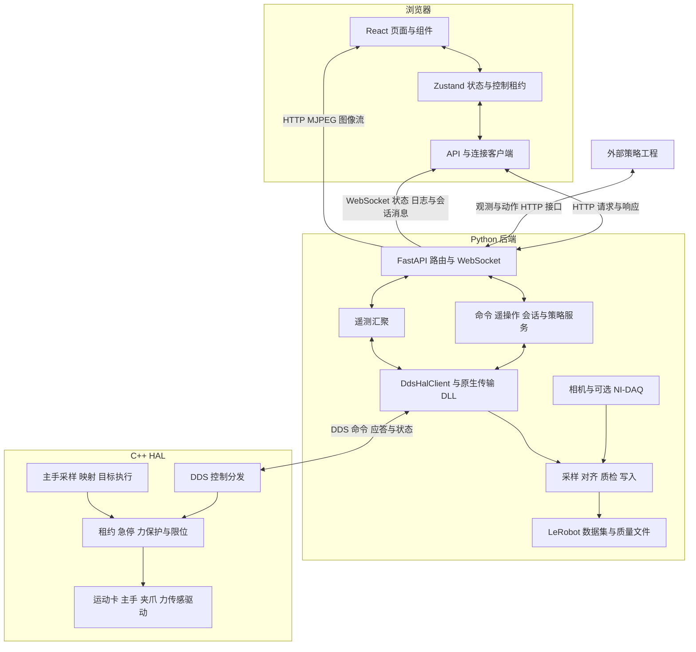

# MicroMani 微装配数据采集平台知识框架与学习路线

本平台需要掌握的知识可以按一条业务链组织：**操作者发出意图，软件把意图转换为受约束的设备动作，传感器返回观测，采集系统把观测与动作组织成数据，后续策略再通过受保护的接口使用这些数据。** React、FastAPI、DDS、C++ 和 LeRobot 分别承担这条链上的不同职责。

本文面向希望理解平台原理并逐步具备开发能力的学习者。它同时回答四个问题：系统怎样组成、为什么采用这些技术、代码与知识点怎样对应、按什么顺序学习和验证。

**版本基准：2026 年 9 月 17 日当前本地工作区。** 包括工作区已有的未提交改动。技术版本按依赖文件的声明说明，不把版本范围当成实际安装版本；“选型理由”是结合本项目职责作出的工程分析，不冒充原作者的历史决策。本文完成了静态源码核对，未启动设备、执行运动或开展性能测量。

逐文件定位见配套的[源码知识索引](<D:/E2EAPP_MicroMani/docs/平台源码知识索引.md>)。原有[代码阅读指南](<D:/E2EAPP_MicroMani/docs/CODE_READING_GUIDE.md>)可辅助导航；与当前代码不一致的旧说明，在本文相关章节中单独指出。

## 阅读导航

- [1 学习目标与知识之间的关系](#k1)
- [2 平台总体框架与当前能力边界](#k2)
- [3 技术选型与基础知识](#k3)
- [4 前端知识体系](#k4)
- [5 后端与数据采集知识体系](#k5)
- [6 HAL 与硬件控制知识体系](#k6)
- [7 跨层调用链与数据契约](#k7)
- [8 测试 构建 启动与排错](#k8)
- [9 分阶段学习路线与综合练习](#k9)
- [10 官方资料与阅读方法](#k10)

## 1 学习目标与知识之间的关系

### 1.1 学会解释一个完整动作

以“界面上点击一次手动移动”为例，真正理解它需要能回答：按钮如何产生事件，输入如何校验，请求发到哪里，谁判断当前能否运动，单位怎样转换，哪一层接触厂商 SDK，成功应答代表什么，实际位置怎样回到界面，以及通信中断后谁停止运动。

因此，学习顺序宜先沿完整功能纵向贯通，再横向扩展技术细节。只学习框架 API，容易会写页面却不知道命令是否真正执行；只看运动算法，也容易忽略时间戳、失联、数据格式与记录可靠性。

### 1.2 三种学习深度

| 深度 | 需要达到的能力 | 建议先完成的任务 |
| --- | --- | --- |
| 理解系统 | 能画出模块图、说清命令和数据流向、区分界面值与实测值 | 读第 2、3、7 章并完成一条调用链笔记 |
| 独立开发 | 能改一个字段或页面，覆盖生产者、传输、消费者和测试 | 读对应技术章节，完成带替身的局部练习 |
| 研究与优化 | 能定义误差、延迟、质量及失败指标，设计可重复的对比实验 | 深入采集、控制与并发，完成第 9 章综合练习 |

“完整知识框架”指覆盖这些依赖关系与平台自有模块，不要求先精通所有第三方库内部实现。第一遍不需要逐行读虚拟环境、`node_modules`、设备厂商二进制或生成文件。

## 2 平台总体框架与当前能力边界

### 2.1 三个主要运行层

| 层 | 在哪里运行 | 核心职责 | 不宜误解成 |
| --- | --- | --- | --- |
| 浏览器前端 | 浏览器中的 JavaScript | 页面、交互、配置编辑、遥测呈现、连接状态与控制入口 | 负责高频运动控制的实时控制器 |
| Python 后端 | Uvicorn/FastAPI 进程及其工作线程或可选子进程 | 配置、业务流程、会话、录制、遥测汇聚、策略桥接 | 一个接口返回成功就证明硬件到位 |
| C++ HAL | Windows 原生进程和设备相关工作线程/进程 | 厂商 SDK、遥操作采样与映射、运动执行、力运行时及执行保护 | 已取得硬实时或功能安全认证的系统 |

HAL 是 Hardware Abstraction Layer，即硬件抽象层。它把具体设备 API 收敛为平台可使用的控制与状态接口。项目在本机有多个进程边界，但不必把它理解为云端微服务系统。

这张图表示职责与信息方向，不表示所有箭头都在同一线程中同步运行。特别是相机预览、录制采样和运动控制各有自己的节奏。

### 2.2 目录在架构中的位置

| 目录 | 应学习的内容 | 典型入口 |
| --- | --- | --- |
| `frontend/src/views` | 页面如何组合功能 | [RecordPage.tsx](<D:/E2EAPP_MicroMani/frontend/src/views/RecordPage.tsx>) |
| `frontend/src/components` | 复用控件、业务组件、错误边界 | [AppLayout.tsx](<D:/E2EAPP_MicroMani/frontend/src/components/AppLayout.tsx>) |
| `frontend/src/stores`、`api` | 状态、连接、命令与遥测 | [telemetry.ts](<D:/E2EAPP_MicroMani/frontend/src/stores/telemetry.ts>)、[API](<D:/E2EAPP_MicroMani/frontend/src/api/index.ts>) |
| `backend/core` | 数据模型、默认值、配置与单位等共享规则 | [schemas.py](<D:/E2EAPP_MicroMani/backend/core/schemas.py>) |
| `backend/services` | 业务流程、状态转换、录制与策略边界 | [app_factory.py](<D:/E2EAPP_MicroMani/backend/app_factory.py>) |
| `backend/drivers`、`workers` | Python 设备接入及可选进程隔离 | [camera_opencv.py](<D:/E2EAPP_MicroMani/backend/drivers/camera_opencv.py>) |
| `backend/hal_client`、`native` | Python 至 C++ 的通信与原生绑定 | [dds_runtime.py](<D:/E2EAPP_MicroMani/backend/hal_client/dds_runtime.py>) |
| `hal/include`、`src`、`dds` | C++ 接口、实现与通信类型 | [HalServer.cpp](<D:/E2EAPP_MicroMani/hal/src/HalServer.cpp>) |
| `scripts` | 构建、启动、部署、诊断和数据工具 | [start-stack.ps1](<D:/E2EAPP_MicroMani/scripts/start-stack.ps1>) |
| 各层测试目录或测试文件 | 行为契约、拒绝路径、回归场景 | [源码知识索引](<D:/E2EAPP_MicroMani/docs/平台源码知识索引.md>) |

### 2.3 先区分五类“事实”

1. **代码中的实现**：某个函数确实执行了字段转换、发送或写入。
2. **默认配置**：代码默认选择某驱动，不代表现场运行配置一定相同。
3. **界面展示**：文案、初始值和演示曲线，不一定来自传感器或模型。
4. **测试证据**：在替身、样本或特定构建条件下满足断言。
5. **实机结论**：需要现场配置、测量条件和实验记录支持。

本次阅读中需要特别注意的当前状态如下。

| 容易形成的印象 | 当前源码可支持的结论 | 证据入口 |
| --- | --- | --- |
| 前端采用 Ant Design | 当前依赖未列 `antd`，主要使用自建 `ui.tsx` 与 CSS；旧流程和分包配置有残留说明 | [package.json](<D:/E2EAPP_MicroMani/frontend/package.json>)、[ui.tsx](<D:/E2EAPP_MicroMani/frontend/src/components/ui.tsx>) |
| `npm run dev` 必然提供热更新 | 当前脚本先构建，再用自有静态服务器提供 `dist` | [package.json](<D:/E2EAPP_MicroMani/frontend/package.json>) |
| 当前力源必然是历史硬件清单中的 Nano-17/NI-DAQ | 当前默认 `force.source` 是 `hkvl_serial`；另有 NI-DAQ 标定采样实现。实际接线仍需运行配置与实物核对 | [defaults.py](<D:/E2EAPP_MicroMani/backend/core/defaults.py>)、[force_nidaq.py](<D:/E2EAPP_MicroMani/backend/drivers/force_nidaq.py>) |
| 模型显示 running 即完成模型加载 | `PolicyService` 的登记与状态切换本身没有加载权重和执行神经网络推理 | [policy_service.py](<D:/E2EAPP_MicroMani/backend/services/policy_service.py>) |
| 微调页面已经实现训练 | 当前微调服务创建 `planned` 任务；真实训练循环不在此实现中 | [policy_service.py](<D:/E2EAPP_MicroMani/backend/services/policy_service.py>) |
| 自动页面的频率和延迟都是实测值 | 存在固定文案和计算展示，部分算法/模式选项只保存在页面本地状态 | [AutoView.tsx](<D:/E2EAPP_MicroMani/frontend/src/views/AutoView.tsx>) |
| 录制文件包含所有原始高频流 | 当前主要输出对齐训练帧和 episode 级质量统计，不能据此宣称保存了全部原始流和逐帧质量掩码 | [dataset_recorder.py](<D:/E2EAPP_MicroMani/backend/services/dataset_recorder.py>) |
| Fast-DDS 使用 ROS 安装目录，所以项目就是 ROS 2 节点系统 | 链接路径提供 Fast-DDS 库；当前控制通路需要按原生 DDS 实现理解 | [CMakeLists.txt](<D:/E2EAPP_MicroMani/hal/CMakeLists.txt>) |

## 3 技术选型与基础知识

### 3.1 技术不是孤立清单

下表的理由来自当前职责分工。理解取舍比记住名称更重要。

| 技术 | 项目声明或使用情况 | 它解决的问题 | 需要同时理解的代价或限制 |
| --- | --- | --- | --- |
| TypeScript | `^6.0.3` | 对复杂配置、遥测和动作请求进行静态类型约束 | 类型在运行时消失，外部 JSON 仍需校验 |
| React / React DOM | `^18.3.1` | 用状态描述页面并复用交互组件 | 闭包、Effect 清理和渲染频率需要管理 |
| React Router | `^6.30.3` | 页面路由、布局与导航 | 路由切换不应意外重复创建控制连接 |
| Zustand | `^5.0.12` | 多页面共享实时状态及操作入口 | 大仓库会增加耦合，选择器和更新粒度影响性能 |
| Vite | `^8.0.10` | 编译打包、资源处理和按需分包 | 构建配置与真正启动命令需要分别阅读 |
| Python | `>=3.12` | 业务编排、数据处理与设备周边生态 | 同步 SDK 和耗时任务可能阻塞事件循环 |
| FastAPI / Starlette / Uvicorn | 分别声明 `>=0.137.1` / `>=1.0.1` / `>=0.32.0` | API 框架、ASGI 能力与服务器运行 | 异步路由不自动使内部所有代码非阻塞 |
| Pydantic | `>=2.10.0` | 配置与请求模型解析、类型约束、序列化 | 结构合法不等于设备状态允许执行 |
| C++20 | CMake 声明 | 原生 SDK、线程与硬件访问 | 内存/资源生命周期、ABI、锁和错误边界更复杂 |
| Fast-DDS / Fast-CDR | CMake 链接 2.14 / 2.2 库名 | 发布订阅、命令状态分离、序列化 | QoS、线程阻塞、超时与消息语义仍需设计 |
| OpenCV | `>=4.10.0` | 相机采集、图像转换和编码 | USB 带宽、相机驱动、曝光与帧缓存影响时序 |
| LeRobot dataset | 可选依赖 `>=0.5.2` | 以训练可消费的方式组织状态、动作、图像和片段 | 数据格式兼容不保证动作标签和时间对齐正确 |
| pytest / Vitest / Testing Library | 各层开发依赖 | 自动复现边界与回归行为 | 替身测试不覆盖真实设备时延和机械风险 |

版本声明来源：[前端依赖](<D:/E2EAPP_MicroMani/frontend/package.json>)、[后端依赖](<D:/E2EAPP_MicroMani/backend/pyproject.toml>)、[HAL 构建](<D:/E2EAPP_MicroMani/hal/CMakeLists.txt>)。`^` 与 `>=` 表示允许范围，前端精确依赖解析还应查看锁文件。本文没有要求升级任何依赖。

### 3.2 三种语言怎样执行

| 源文件 | 变成什么 | 在哪里执行 | 调试时先看什么 |
| --- | --- | --- | --- |
| `.ts`、`.tsx`、`.css` | 浏览器可加载的 JS/CSS 与静态资源 | 浏览器；Node 用于构建和提供静态文件 | Console、Network、React 状态、生成包对应源码 |
| `.py` | Python 解释器执行的模块与函数 | 后端进程、线程、可选工作进程 | Traceback、日志、协程任务及外部调用耗时 |
| `.h`、`.cpp` | 编译链接后的 `.exe` / `.dll` | Windows 原生进程 | 编译/链接错误、DLL 加载、线程、驱动返回码 |

`.h` 描述类型与接口，`.cpp` 实现行为。Python 的类型标注通常用于可读性与静态检查，Pydantic 等才在特定边界执行运行时验证。TypeScript 的 `as SomeType` 是类型断言，不会替你检查服务端 JSON 的真实性。

### 3.3 编程基础对应到平台问题

| 基础概念 | 在本平台中的具体意义 | 入门练习 |
| --- | --- | --- |
| 函数、对象、模块、导入 | 把设备读取、业务判断、页面显示分开 | 画出一个文件的输入、输出和依赖 |
| 数组、字典、集合、队列 | 轴状态、配置树、遥操作来源、待写帧 | 对 12 维数组做边界检查；模拟有限长度队列 |
| 可变对象与不可变更新 | UI 是否检测到变化，配置是否被意外共享修改 | 比较原地修改与创建新对象的结果 |
| Promise、协程、`await` | 请求等待期间还要处理界面或其他连接 | 在替身中加入延迟，观察并发请求行为 |
| 线程、进程、锁 | 隔离阻塞 SDK，保护共享状态，划分崩溃边界 | 用计数器演示竞态，再使用明确同步方式 |
| 超时、取消、幂等 | 请求超时后，设备可能已执行；重复运动可能累计 | 把“未发出”“已发出未确认”“确认失败”分开记录 |
| 生命周期 | 相机、串口、DLL、订阅和线程都需要释放 | 为获取资源画出对应释放路径 |
| 状态机 | 连接、录制、控制租约、急停各有不同状态 | 写出允许转换和禁止转换的表 |
| 时间与数值误差 | 帧对齐、陈旧判断、单位与浮点比较 | 区分 Unix 时间、单调时间、帧索引和频率 |

### 3.4 必要的数学与实验基础

- **线性代数**：向量、矩阵、坐标变换，用来理解轴映射与力标定；矩阵尺寸正确还不够，输入顺序和单位也必须正确。
- **微积分与控制基础**：速度是位移变化率，离散控制使用实际采样间隔；积分、滤波、饱和和延迟会改变系统响应。
- **概率统计**：平均值、标准差、分位数、最大值、重复实验。平均时延小不能掩盖偶发的大延迟。
- **信号处理**：采样、混叠、滤波、重采样与插值。低通滤波可减小噪声，也会引入响应延迟。
- **实验设计**：保持比较条件一致，区分传感器误差、时间对齐误差、机械定位误差与模型误差。

基础数学用于解释代码与设计实验，不意味着当前仓库已经实现完整机器人动力学、通用逆运动学或硬件同步系统。

## 4 前端知识体系

