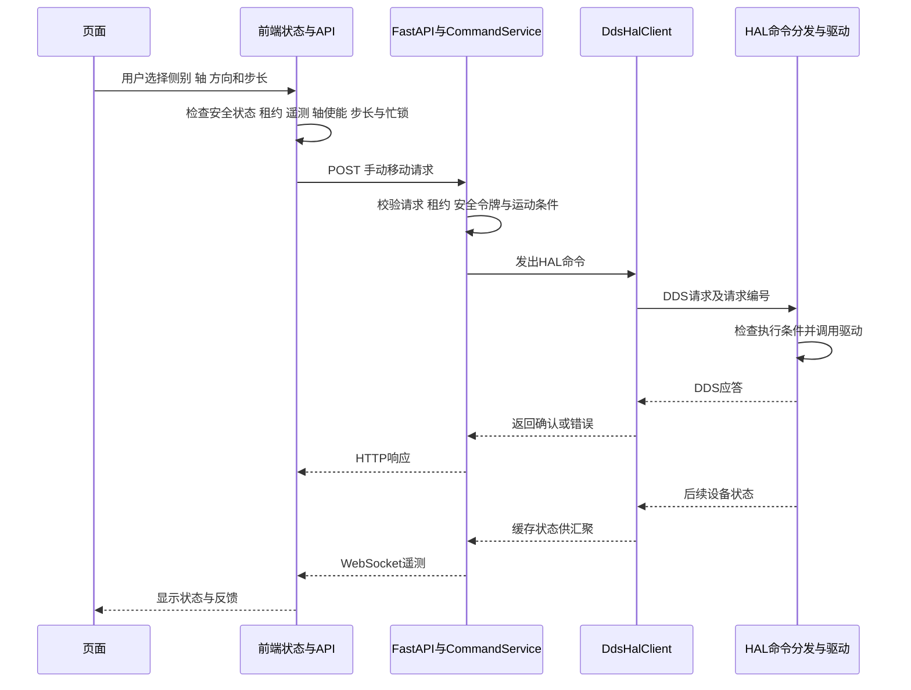
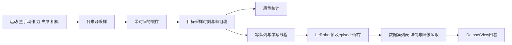

<a id="k7"></a>

## 7 跨层调用链与数据契约

### 7.1 四种数据不要混用

| 数据 | 它表达什么 | 常见错误 |
| --- | --- | --- |
| 操作者输入 | 主手动作、按钮或模式选择 | 直接当成从手机构已完成的动作 |
| 控制目标 | 映射、缩放和约束后的设备命令 | 将发送成功显示为已经到位 |
| 设备反馈 | 设备接口返回的位置、力或状态 | 没有检查采样来源、新鲜度和有效性 |
| 学习标签 | 为训练定义的 `observation` 与 `action` | 认为标签天然就是“专家真实执行轨迹” |

字段名称只是入口，实际语义应追踪赋值来源。例如本项目录制 `action` 的构造与原生遥操作增量有关；DDS 发布目标与执行端实际结果之间还有保护、限幅和设备行为，二者不能直接等同。

### 7.2 手动移动的完整链路



阅读时依次搜索 `issueManualAxisMove`、`manualAxisMove`、`manual_axis_move` 和对应 HAL 命令。证据入口：[ManualControlPanel](<D:/E2EAPP_MicroMani/frontend/src/views/settings/ManualControlPanel.tsx>)、[telemetry store](<D:/E2EAPP_MicroMani/frontend/src/stores/telemetry.ts>)、[API 客户端](<D:/E2EAPP_MicroMani/frontend/src/api/index.ts>)、[路由](<D:/E2EAPP_MicroMani/backend/app.py>)、[CommandService](<D:/E2EAPP_MicroMani/backend/services/command_service.py>)、[HalCommandDispatcher](<D:/E2EAPP_MicroMani/hal/src/HalCommandDispatcher.cpp>)。`motionCommands.ts` 主要管理使能/断使能确认，应按第 4.6 节的另一条调用链学习。

需要自行画出两条分支：请求发出前被拒绝；请求已发出但应答超时。后一种情况的执行结果可能未知，不能简单自动重发一个具有物理累积效果的移动。

### 7.3 录制不依赖浏览器逐帧抓取

浏览器负责开始、保存、丢弃和结束等用户操作。Python 录制服务负责采样与落盘。页面显示的低频汇总不应成为训练数据的唯一来源。



沿[录制控制组件](<D:/E2EAPP_MicroMani/frontend/src/components/record/EpisodeControlPanel.tsx>)和[DatasetRecorderService](<D:/E2EAPP_MicroMani/backend/services/dataset_recorder.py>)，分别理解 session、episode、frame 三个层次：

- session 决定一次采集会话使用的数据集、配置和服务资源。
- episode 对应一段任务轨迹，是保存、丢弃、标注和数据划分的重要单位。
- frame 是某个目标采样时刻的观测与动作组合。

停止采集、保存当前片段、丢弃当前片段、结束会话是不同语义。当前 `finish_session` 对仍在录制的未保存片段存在清空缓冲的处理，不能把“结束”描述成自动保存全部数据。

### 7.4 控制生命期与数据生命期不同

WebSocket 连接存在不等于控制权限有效。浏览器、Python 和 HAL 各有可能停止更新；控制租约需要用明确的心跳应答及 HAL 确认建立。录制任务还可能因安全事件中断。

学习时分别画四张状态表：

1. 网络连接：未连接、连接中、在线、重连、关闭。
2. 控制会话：等待验证、有效、失效、需要恢复。
3. 录制：未开始、录制中、保存或丢弃、等待复位、结束。
4. 执行保护：可运行、急停锁存、力锁存、限位或状态异常，以及各自恢复条件。

这些名称是阅读用的概念分组，具体枚举与标志以源码为准。不能用一个 `connected = true` 概括全部状态。

### 7.5 单位与维数的项目约定

| 表达 | 当前约定 | 学习重点 |
| --- | --- | --- |
| 双侧运动状态 | 每侧 X、Y、Z、Roll、Pitch、Yaw，共 12 维 | 先确认是运动轴状态，不能只因字段叫 `joints` 就当作通用串联关节角 |
| 界面平移 | μm | 确认脉冲比例、符号和原点 |
| 界面旋转 | degree | 不直接送入要求毫度的训练接口 |
| 项目 LeRobot 表达中的旋转 | 0.001 degree | 这是本平台定义，不是所有 LeRobot 数据集的通用规定 |
| 策略状态与动作 | 每侧 6 轴加夹爪，共 14 维 | 插入夹爪后，旋转轴索引已经改变 |
| 夹爪宽度 | mm | 与平移 μm 区分 |
| 操作者侧别 | 与历史硬件 left/right 存在交叉映射 | 统一经过映射函数，不在多处交换数组 |

举例：界面旋转 `0.02 degree` 在本项目训练表示中为 `20 mdeg`；平移 `50 μm` 的单位不随旋转换算改变。一个数值必须和单位、坐标系、侧别、时间及来源一起理解。

证据：[units.py](<D:/E2EAPP_MicroMani/backend/core/units.py>)、[operator_view.py](<D:/E2EAPP_MicroMani/backend/core/operator_view.py>)、[policy_bridge.py](<D:/E2EAPP_MicroMani/backend/services/policy_bridge.py>)。练习应使用这些函数及对应测试，不在学习代码中散布补偿常数。

### 7.6 数据采集与具身学习怎样衔接

从机器学习角度，一条示教样本要明确：观测 `o_t` 是哪些相机与哪些状态；动作 `a_t` 是绝对目标、相对增量还是速度；动作对应观测前后哪个时刻；一个动作执行多长时间；失败、中止和缺失怎样标记。

需要依次学习：监督学习与训练/验证划分、模仿学习、行为克隆、时序模型、动作分块、归一化、分布偏移、离线评估与闭环评估。ACT、Diffusion Policy、VLA 是后续策略方向，先把数据语义和输入输出桥接学清楚。

本仓库中的模型列表、自动队列和策略 HTTP 接口，与真正训练网络的工程是不同层次。[run-act-deploy.ps1](<D:/E2EAPP_MicroMani/scripts/run-act-deploy.ps1>)与[run-act-jepa-deploy.ps1](<D:/E2EAPP_MicroMani/scripts/run-act-jepa-deploy.ps1>)调用外部部署程序；本文没有审计这些外部工程，所以不推断其具体网络结构、损失函数或实测性能。

### 7.7 修改一个跨层字段的思考顺序

假设未来要增加一个“样本是否过期”的字段，先问它从哪一层能够可靠获知，再依次核对：

1. 源头是否有真实时间戳和有效性信息。
2. HAL 类型、序列化和状态发布是否需要增加字段。
3. Python 传输、schema 和汇聚是否保留它。
4. API 与 WebSocket 是否一致传递。
5. 前端类型、默认值、选择器与显示是否正确处理旧版本缺字段。
6. 录制文件是否需要写入逐帧标记，而不仅是汇总统计。
7. 测试是否覆盖新鲜、过期、缺字段和断连。

这是一种学习用的跨层检查方法，不表示上述新增功能已经实现。

<a id="k8"></a>

## 8 测试 构建 启动与排错

### 8.1 验证是逐层积累的证据

| 验证类型 | 能回答的问题 | 不能替代的验证 |
| --- | --- | --- |
| TypeScript / mypy | 类型与部分结构是否一致 | 设备动作和运行时 JSON 是否真实 |
| ESLint / Ruff | 是否存在规则可识别的代码问题 | 业务行为是否正确 |
| 纯函数与替身单元测试 | 输入转换、状态门控、异常分支是否符合断言 | SDK 与设备真实行为 |
| 前后端集成测试 | 路由、服务、组件交互是否符合约定 | 真实网络时延与驱动稳定性 |
| C++ 编译和原生测试 | 当前构建条件下类型、链接或独立逻辑是否成立 | 开关关闭时未编译到的 DDS/厂商路径 |
| 日志与压力测试 | 给定负载下的队列、延迟和故障情况 | 未测配置与长时间运行情况 |
| 实机实验 | 指定条件下的设备与任务表现 | 所有型号、工件与环境的普遍可靠性 |

本次生成文档没有运行这些测试，以下是学习时的检查入口。

```powershell
# 从仓库根目录运行；先确认现有依赖环境与测试替身配置。
npm --prefix frontend run typecheck
npm --prefix frontend test -- src/stores/controlLease.test.ts
npm --prefix frontend test -- src/components/CameraPreview.test.tsx

backend/.venv/Scripts/python.exe -m pytest backend/tests/test_units.py backend/tests/test_operator_view.py -q
backend/.venv/Scripts/python.exe -m pytest backend/tests/test_hal_protocol.py backend/tests/test_policy_bridge.py -q
```

这些是后续学习示例，不是本次已经通过的结果。数据集测试还需要可选依赖；`skip` 必须与通过区分。HAL 的构建目标、可用 SDK 与原生测试入口以当前 CMake 和构建脚本为准。

### 8.2 启动脚本是一部分系统设计

| 入口 | 实际需要学习的内容 | 使用前关注 |
| --- | --- | --- |
| [Start-App.cmd](<D:/E2EAPP_MicroMani/Start-App.cmd>)、[launch-app.ps1](<D:/E2EAPP_MicroMani/scripts/launch-app.ps1>) | 启动或复用服务、检查端口、打开浏览器 | 可能涉及真实 HAL 与设备连接 |
| [start-stack.ps1](<D:/E2EAPP_MicroMani/scripts/start-stack.ps1>) | HAL、Python、前端的顺序及环境变量 | 会清理匹配进程、启动真实模式，并重新构建前端 |
| [start-hal.ps1](<D:/E2EAPP_MicroMani/scripts/start-hal.ps1>) | 候选二进制、SDK/DLL、设备参数与健康检查 | `/health` 路径可能触发驱动准备，不是纯离线阅读操作 |
| [Start-UI.cmd](<D:/E2EAPP_MicroMani/Start-UI.cmd>)、[start-ui.ps1](<D:/E2EAPP_MicroMani/scripts/start-ui.ps1>) | 已有服务复用，必要时创建 test HAL 后端 | 已存在的后端会被复用；test HAL 也不自动替换全部周边驱动 |
| [stop-stack.ps1](<D:/E2EAPP_MicroMani/scripts/stop-stack.ps1>) | 进程树与资源清理 | 停止脚本和受控运动停止具有不同语义 |
| [normalize_origin.py](<D:/E2EAPP_MicroMani/scripts/normalize_origin.py>) | 数据原点变换与预演 | 区分 dry-run 和实际改写 |
| [push_dataset_to_hub.py](<D:/E2EAPP_MicroMani/scripts/push_dataset_to_hub.py>) | 本地数据集与远端发布 | 上传是真正的外部写入操作 |

当前常用脚本默认端口包括前端 `5174`、后端 `18082`、HAL 诊断 `8091`，DDS 默认域由配置与环境变量控制。它们是脚本默认值，不是不可改变的协议规范。

### 8.3 构建期变量与运行期变量

`VITE_API_BASE` 等前端变量通常在构建时进入浏览器代码；改完服务器环境变量而不重新构建，旧 `dist` 未必改变。Python/HAL 的环境变量则通常在进程创建或初始化时读取。配置文件又可能在运行中由服务加载。

需要区分三个时刻：安装依赖时、构建产物时、启动进程时。排查“改了配置没生效”，先定位这个值在哪个时刻读取，不要反复猜端口。

### 8.4 按边界排错

| 现象 | 推荐的证据顺序 |
| --- | --- |
| 按钮无法使用 | 当前选择器和禁用原因 → 连接/租约/安全状态 → 对应后端判断 |
| 请求成功但数值没变化 | HTTP 返回语义 → DDS 请求及应答 → 实际执行状态 → 遥测新鲜度 → UI 投影 |
| 相机有图但录制缺图 | 预览路径 → 采样路径 → 相机绑定及帧时间 → 组装回退 → 写队列 |
| 力曲线方向不符 | 传感器原始通道 → 标定与去皮 → 坐标方向 → 侧别映射 → 页面单位 |
| 录制越来越迟 | 输入频率与处理耗时 → 组装队列 → 写队列 → 编码/磁盘 → 丢弃和超时策略 |
| 停止后又出现旧动作 | 异步任务代次 → 命令已发出边界 → 队列失效 → HAL deadline/急停检查 |

最有价值的日志包含请求 ID、时间、模块、侧别、配置或会话标识、结果和错误类别。大量逐帧日志可能反过来改变时序，排错时要控制日志量。

<a id="k9"></a>

## 9 分阶段学习路线与综合练习

### 9.1 按掌握程度推进

以下阶段按依赖排序，不预设你的已有水平或学习周期。已能完成阶段验收的部分可以跳过。

| 阶段 | 学习重点 | 读源码的范围 | 需要交付的学习成果 |
| --- | --- | --- | --- |
| A 系统认识 | 进程、模块、命令和状态区别 | 本文第 2、7 章；应用入口与架构图 | 自己画一张不看答案的运行图，并讲清四类数据 |
| B 语言与网页基础 | JS/TS、HTML/CSS、Python 模块、类型与异常 | `types.ts`、`schemas.py`、简单 UI 与单位函数 | 写纯函数测试，完成有效/无效输入转换 |
| C 前端数据流 | React、路由、Effect、Zustand、请求状态 | `App`、API、store、一个录制组件 | 用离线替身展示连接、过期、失败三种状态 |
| D 后端业务 | HTTP、ASGI、Pydantic、服务装配、asyncio | `create_app`、`create_services`、命令与配置 | 画出依赖关系，用 fake HAL 验证一条拒绝路径 |
| E 契约与并发 | DDS、请求应答、线程队列、取消与代次 | `hal_client`、watchdog、safety gate | 复现“请求准备中发生停止”，说明旧任务如何失效 |
| F 原生控制 | C++、RAII、SDK、运动单位、力处理 | 同名 `.h`→`.cpp`，从驱动接口到执行器 | 解释一个目标从 UI 单位到驱动调用的全过程 |
| G 数据采集 | 时钟、缓存、对齐、episode、数据格式 | recorder、相机、policy bridge | 用合成时间序列验证错位和缺样，再读取临时数据集 |
| H 综合评估 | 压力、错误注入、数据划分、指标设计 | 三层相关测试与部署脚本 | 完成一份可重复的离线实验报告和能力限制说明 |

### 9.2 六个不需要实机运动的练习

1. **单位练习**：读取 `test_units.py`，用若干正负值验证 UI 与训练状态往返转换。检查旋转索引和夹爪插入位置，说明为什么不能对 14 维数组直接套 12 维索引。
2. **页面练习**：在独立练习组件中输入一个假的遥测对象，分别显示在线、陈旧、缺失；写可观察行为测试，不依赖内部 state 名称。
3. **竞态练习**：让 fake HAL 延迟返回，在等待期间触发停止，检验旧操作能否越过新的安全代次。
4. **对齐练习**：生成不同频率的时间序列，加入固定偏移、抖动和缺样；比较最近邻匹配与插值，报告误差分布和失效条件。
5. **队列练习**：用较快生产者与较慢消费者构造积压，比较无界队列、有限队列和超时失败的行为；解释为何录制与控制不能共用任意阻塞路径。
6. **数据练习**：在临时目录构建少量 episode，检查字段、单位、图像关联和保存/丢弃边界；按 episode 划分训练测试，禁止把同一轨迹相邻帧随机打散后当独立样本。

练习应在独立测试、临时目录或已有替身中完成。不要为了学习某段接口直接调用运行中的硬件服务。

### 9.3 综合练习题

题目：设计一个离线“采集回看实验”，输入包含运动、力、夹爪和图像索引的合成流，输出 episode 与质量报告，再用一个简单页面浏览结果。

验收要求：

- 数据含至少两种采样频率，明确时间单位与起点。
- 正常、延迟、缺样和停止四种情况能够被区分。
- 请求返回、任务结束、数据写入完成是三个可说明的事件。
- 每个关键数值带有单位、来源和有效性说明。
- 保存与丢弃行为有测试，修改配置会形成新的记录版本或明确边界。
- 所有结论只覆盖离线合成场景，不把回看成功表述为实机装配成功。

通过这个练习，可以把前端、后端、并发和数据处理串起来，再进入原生设备与实机评估。

### 9.4 判断自己是否已经理解

能独立回答下面问题，说明已经建立平台级逻辑：

- 为什么 React 界面刷新频率、录制帧率和主手控制循环频率可以不同？
- 为什么设备“已连接”、遥测“新鲜”和控制租约“有效”需要分开？
- `async def` 内部调用一个慢 SDK，为什么仍可能卡住其他请求？
- 为什么超时不等于设备未执行，取消等待也不等于终止底层线程？
- 为什么 DDS reliable 不直接等于业务动作恰好执行一次？
- 为什么同名 `left` 在不同层可能需要转换？
- 为什么本项目 12 维运动与 14 维训练状态需要不同的索引理解？
- 采样时间、接收时间、目标组装时间和写盘时间分别用于什么？
- 为什么 `action` 的具体生成方法会影响训练效果？
- 模型显示 running、模型完成推理、动作成功下发、设备到位分别由什么证据证明？
- 力信号滤波为什么不能无条件搬到停机判断之前？
- 哪些结果只能通过原生构建、真实 DDS 运行或实机实验补充？

<a id="k10"></a>

## 10 官方资料与阅读方法

以下入口已于 2026 年 9 月 17 日浏览核对。文档页面可能面向比项目更高的版本；学习基础概念后，应回到项目锁定或实际安装版本核对 API。

| 知识 | 官方入口 | 优先阅读内容 |
| --- | --- | --- |
| TypeScript | [Handbook](https://www.typescriptlang.org/docs/handbook/intro.html) | 函数、对象类型、联合类型、类型收窄、泛型 |
| React | [Learn React](https://react.dev/learn) | 组件、状态、事件、共享状态及 Effect 生命周期；留意本站当前文档版本 |
| React Router 6 | [v6 教程](https://reactrouter.com/6.30.1/start/tutorial) | 路由、布局、导航与 URL 状态 |
| Zustand | [官方仓库与文档入口](https://github.com/pmndrs/zustand) | store、selector、不可变更新与订阅 |
| Vite | [Guide](https://vite.dev/guide/) | 构建、环境变量、资源与输出；对照项目自定义 dev 脚本 |
| Python asyncio | [Python 3.12 文档](https://docs.python.org/3.12/library/asyncio.html) | task、取消、timeout、同步原语与线程桥接 |
| FastAPI | [Tutorial](https://fastapi.tiangolo.com/tutorial/) | 请求/响应模型、错误处理、依赖和 WebSocket |
| Pydantic | [官方验证文档](https://docs.pydantic.dev/latest/) | 模型、验证、序列化与配置；选择与项目兼容的版本 |
| Fast-DDS | [2.14 系列 DDS 层](https://fast-dds.docs.eprosima.com/en/v2.14.5/fastdds/dds_layer/dds_layer.html) | participant、topic、writer/reader、QoS 与发现 |
| C++ 与 MSVC | [Microsoft C++ 文档](https://learn.microsoft.com/en-us/cpp/cpp/?view=msvc-170) | 类型、资源管理、异常、编译和运行库 |
| CMake | [官方教程](https://cmake.org/cmake/help/latest/guide/tutorial/index.html) | target、include、link、编译特性与选项 |
| OpenCV | [VideoCapture](https://docs.opencv.org/4.x/d8/dfe/classcv_1_1VideoCapture.html) | 打开设备、读取帧、backend、属性与释放 |
| LeRobot | [LeRobotDataset v3](https://huggingface.co/docs/lerobot/lerobot-dataset-v3) | features、episode、Parquet、视频与元数据 |
| pytest | [官方文档](https://docs.pytest.org/en/stable/) | assert、fixture、参数化、临时目录与替换依赖 |
| Vitest | [Guide](https://vitest.dev/guide/) | mock、定时器、异步断言与测试隔离 |
| React Testing Library | [官方介绍](https://testing-library.com/docs/react-testing-library/intro/) | 按用户可见行为查询元素并触发交互 |

阅读每一个源码模块时，留下一页笔记：**输入、输出、调用者、资源所有者、可变状态、单位与时间、失败路径、对应测试**。能把这八项写清楚，比先把一个几千行文件从头看到尾更有助于建立知识体系。

配套[源码知识索引](<D:/E2EAPP_MicroMani/docs/平台源码知识索引.md>)按当前文件生成，提供自有源码、测试与构建入口的定位。第三方依赖、厂商二进制、运行数据、输出产物和独立子项目不纳入逐文件学习范围。
