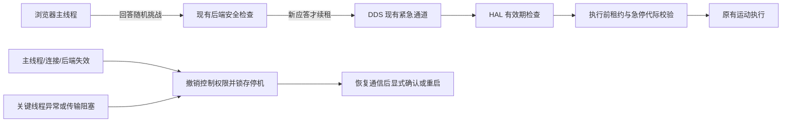

# 现有架构内的故障保护设计与验证

日期：2026-09-11。范围：前端、Python 后端和 C++ HAL 的软件保护。

## 已确认的约束

用户确认控制卡为雷赛 DMC3000 和 DMC5C10，没有实体急停按钮，并明确不增加接线、硬件模块、额外成本或冗杂的部署结构。因此本轮保留现有浏览器、后端、HAL 部署，复用原 WebSocket 和 DDS 通道；没有新增硬件、独立服务进程、浏览器 Worker 或第三方依赖。

本轮只完成软件层能够验证的保护。没有修改控制卡 IO 或固件配置，没有启动或控制真实设备；Windows 整机失效、控制卡/驱动固件故障和原生内存破坏不被宣称已经解决。新增硬件不作为本轮待办或恢复门槛。

## 保护链路

### 1. 主线程失去响应时，不能继续维持控制授权

- 后端每 500 ms 发一个随机挑战；浏览器主线程回答对应会话和 nonce。自动 WebSocket ping、后台 Worker 或单独计时器都不能代替主线程回答。
- 每个已登记页面都要响应；任何一个失联即保守停机，防止另一个健康窗口替卡死的控制窗口维持授权。故障后其他旧会话也失效，需要重新建立连接。
- 后端每次向 HAL 续租都消耗一份新的主线程应答，不重复使用“尚未超时”的旧应答。续租期间收到的新应答留给下一次续租，迟到确认只对应发起时的 nonce。
- 页面暂停后恢复时，先用单调时钟检查旧会话期限，拒绝积压消息。脚本未捕获异常和组件渲染异常也撤销续租，急停和停止入口保留。
- 真实模式没有有效租约时，禁止启动运动和确认安全态。模拟模式显式使用模拟租约状态；不会通过放宽真实路径来迁就测试。

### 2. 后端崩溃或普通命令卡住时，HAL 自己撤销控制权限

- HAL 启动即要求控制租约并保持急停锁存。首次连接、租约到期或更换会话后，心跳不自动解除锁存；必须显式确认，再重新使能/启动。
- HAL 租约期限固定为 2500 ms，由独立于 DDS 普通命令的内部守护线程检查。现有紧急 topic 同时接收受限的 `control.lease` 和急停，普通回原点命令不会占住租约收取循环。
- 续租含后端会话、递增序号、发起时间；重复/倒序、活动会话被替换、超过 1000 ms 的迟到或未来时间请求被拒绝。
- 租约检查下沉到 `LTDMCDriver::commandEpochAllowed` 和实际运动边界，不只限制 UI。SDK 调用返回后仍复核，旧命令不能跨过急停代际继续执行。
- 到期续租必须先锁存。确认安全态需要当前租约新鲜、待执行的停机动作已经完成、急停代际仍匹配。旧停机动作完成不能覆盖更新的停机事件。
- 守护线程故障或退出时，先永久撤销本运行实例的续租和确认资格，再等待 SDK/线程回收；不存在一边等待退出、一边继续接受确认的窗口。

这里的 500/2000/2500 ms 是软件失联检测参数，不是经过真机测定的物理停机时间，也不是制动距离或碰撞安全保证。Windows 调度、传输和 SDK 实际执行时间仍影响结果。

### 3. 原生阻塞不会无界占用后端公共线程池

- DDS 发布、应答等待和缓存读取离开 FastAPI 事件循环及默认 executor。
- 阻塞通道容量分别为普通命令 4、急停 1、租约 1、状态读取 2；容量满即拒绝，不排队。调用超时后，原生调用没有返回就不释放它占用的容量。
- 控制调用超时、取消或原生异常会使传输进入故障隔离状态：停止续租、触发急停、拒绝新控制，要求重启恢复。急停堵塞、无应答或被 HAL 拒绝也停止续租，防止正常心跳掩盖急停通道故障。不会自动重放不确定是否已执行的运动命令；安全停止仍可重试。
- 普通控制请求带执行截止时间，HAL 取出命令时检查；超时请求不能等待其他长命令结束后再迟到执行。原有时间戳和急停代际检查继续保留。
- 当前原生绑定使用 `ctypes.CDLL`，调用期间释放 GIL。独立 Python 线程能避免正常阻塞等待占用事件循环，但仍不能隔离原生 DLL 的地址空间破坏。

### 4. 关键线程异常保持安全优先，并明确恢复方式

- 补齐运动轮询、HKVL 读取、力监控、DDS 普通/紧急循环及 follower 回调的标准与非标准 C++ 异常边界。
- 所有相关软件权限先通过原子状态撤销，然后分别尝试现有停机动作。某动作抛异常不会跳过其余动作；不会简单吞错后继续运动。
- 线程创建失败、只启动了一部分线程、故障后 `running=false` 但线程仍需 join 等路径均处理回收。
- Native 已有显式重启入口的故障保留原有确认/重启路径；力线程故障需重新配置重建；服务中的运动轮询、DDS 和 follower 关键故障不能靠普通 ACK 假恢复，要求重启 HAL。
- HAL 完成对象和回调装配后才启动 DDS 命令接收。正常退出与异常展开共用清理顺序：先撤权，再停止控制线程，最后销毁其引用的发布器和依赖。顶层捕获保证启动异常进入栈展开。

## 协议与运行行为变化

| 入口 | 新行为 |
| --- | --- |
| WS | 增加 `safety_challenge`、`safety_heartbeat`、`control_lease` 消息，绑定会话及 nonce |
| DDS | 复用已有 topic/IDL；增加 `control.lease` 命令及普通控制 payload 的截止时间 |
| 首次启动/重新连接 | 先获得租约并确认安全态，再显式使能；不恢复旧运动 |
| 打开多个页面 | 已登记页面中任意一个失联会触发停机；不会由另一个页面默默续旧控制 |
| 关闭页面或页面长时间卡顿 | 控制租约失效；自动流程也受此约束，本轮不保留无人值守的继续运行模式 |
| 关键传输或 HAL 线程故障 | 明确拒绝控制；没有可靠远程重建入口时要求重启对应进程 |

前端、后端和 HAL 的本次协议需要配套使用。旧前端无法提供挑战应答，旧 HAL 无法确认新租约时，新版本软件会拒绝运动；没有静默回退到缺少保护的旧路径。本轮没有替换正在运行的二进制或重新启动现场服务。

## 验证

最终离线验收结果：

- 前端全套 **341/341**，无失败、无跳过；生产 build、typecheck 和本轮文件定向 ESLint 通过。首次全套发现的旧租约夹具已补齐协议并新增拒绝路径；App 两项等待超时单独复跑 **82/82**，最终全套也通过，没有放宽生产门槛或断言。见 [全套结果](frontend-tests.json)、[构建日志](frontend-build.log)。
- 后端相关组合 **65/65**、既有 WS/急停/ACK/关闭路由 **9/9**，相关模块编译检查通过。真实应用路由协程与 HTTP ASGI 路由覆盖“WS 应答 → HAL 租约确认 → 显式 ACK → 断连急停 → ACK 拒绝”，外部 Socket/HAL 使用替身，没有启动设备生命周期。完整后端集合本轮未重跑；准确命令见 [后端报告](../stability-20260911/CONTROL_LEASE.md)。
- HAL 五个离线程序编译、链接、运行通过：ForceCore **11 组**、EmergencyStop **9 项**、ThreadStability **6 项**、WorkerResilience **14 项**、ControlLease **9 项**。
- HAL 源码契约 **113/113**；真实 SDK 宏下 **11 个源文件仅编译通过**，最新 HalServer 生命周期清理也重新编译通过。
- 浏览器实际暂停主线程、崩溃 renderer、触发未处理拒绝，三个场景均未产生新的有效心跳。暂停/崩溃使用 Chrome DevTools Protocol；所有 API/WS 隔离真实设备。报告中的检测时间来自后端替身，不能换算为真机制动时间。
- 详细证据：[HAL 报告](HAL.md)、[前端报告](FRONTEND.md)、[浏览器故障记录](browser-main-thread.json)。最终 `git diff --check` 通过，只有现有 LF/CRLF 换行提示。

## 保留的架构边界

- 进程内异常边界不能处理访问违规、原生内存破坏、Windows 崩溃或断电。本轮遵从不增加硬件和独立服务的约束，没有实现外部硬件停机通路。
- 无法安全强杀永久堵塞在 SDK 中的线程。后端会限制其数量并撤销控制，HAL 会保留锁存；如果用于物理停止的 SDK 自身永久阻塞，软件无法承诺物理执行完成。
- Fast-DDS 开发 SDK 路径 `F:/opt/ros/jazzy` 仍缺失。DDS 宏分支的运行和 listener 生命周期没有实机/完整 SDK 编译验证；源码契约检查不替代这部分验证。
- 没有执行真机运动、真实 USB/DDS 故障注入或物理停止时间测量。离线通过说明已覆盖的代码行为成立，不代表现有硬件获得了独立安全认证。
